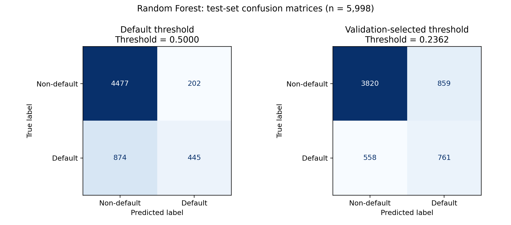
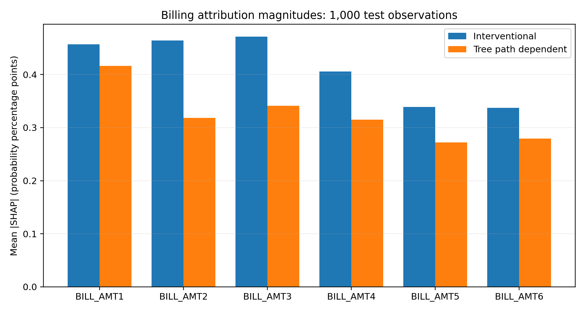
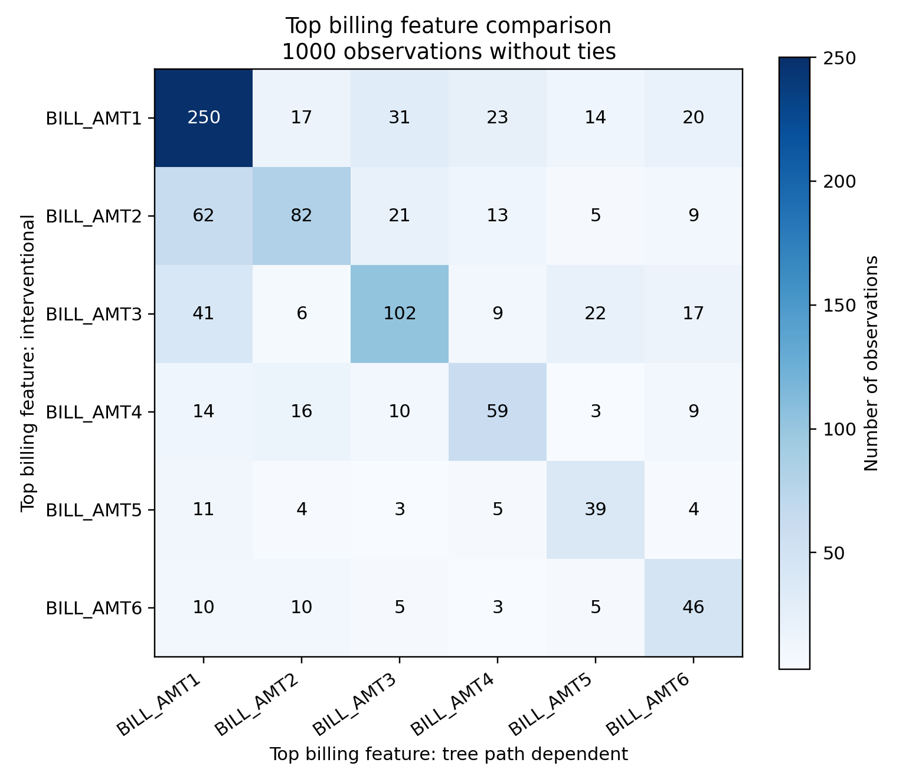
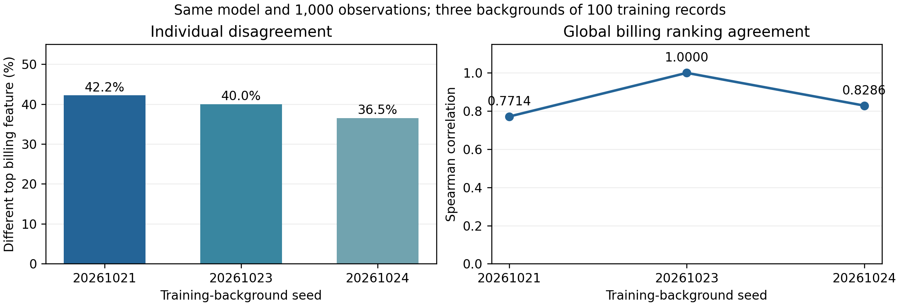

# Panduan konsultasi penelitian TreeSHAP pada prediksi gagal bayar kartu kredit

Disiapkan pada 23 Oktober 2026 untuk konsultasi 24 Oktober 2026.

Panduan ini membantu seluruh anggota menjelaskan masalah penelitian, hubungan dengan Teori Game, cara kerja model, algoritme penjelasan, alur kode, hasil, dan batasan. Angka hasil berasal dari artefak proyek yang sudah tersimpan, bukan eksperimen baru pada laptop ini. Contoh hitungan yang dibuat untuk belajar selalu diberi label ilustrasi.

**Pesan utama:** pada model dan nasabah yang sama, pilihan pengaturan TreeSHAP dapat mengubah pembagian kontribusi antarfitur tagihan. Ranking global yang sama juga belum menjamin penjelasan individual yang sama. Penelitian saat ini merupakan studi empiris pada satu model dan satu dataset, dengan tiga background train.

## 1. Cara menggunakan panduan

Untuk persiapan bersama, ikuti urutan berikut.

1. Baca bagian 2–4 untuk memahami masalah dan keseluruhan alur.
2. Pelajari bagian 5–9 untuk memahami data, Random Forest, Shapley, dan TreeSHAP.
3. Gunakan bagian 10–12 untuk menjelaskan hasil dengan benar.
4. Latihan tanya jawab menggunakan bagian 14. Setiap anggota sebaiknya mencoba menjawab sebelum membaca jawabannya.
5. Gunakan bagian 15–17 untuk menyiapkan presentasi singkat dan keputusan yang ingin diminta dari dosen.

Tujuan belajar bukan menghafal semua angka, melainkan dapat menjawab: apa inputnya, apa yang dipelajari model, apa yang dijelaskan TreeSHAP, apa yang dibandingkan, dan sejauh mana hasil dapat disimpulkan.

## 2. Penjelasan proyek dalam satu menit

> Kami meneliti sensitivitas pembagian atribusi enam fitur tagihan bulanan yang berkorelasi pada prediksi gagal bayar kartu kredit. Model prediksinya adalah Random Forest. Kami kemudian menjelaskan probabilitas gagal bayar menggunakan dua mode TreeSHAP, yaitu interventional dan tree-path-dependent, pada model dan sampel nasabah yang sama. Analisis membandingkan ranking global, fitur tagihan dengan atribusi absolut terbesar per nasabah, serta agregat atribusi kelompok tagihan. Pada background awal, fitur tagihan teratas berbeda pada 42,2% dari 1.000 observasi. Ketika background train diganti, ketidaksepakatan berada pada 36,5–42,2%. Kami ingin berkonsultasi mengenai kecukupan lingkup ini serta pengembangan yang paling relevan untuk paper.

Judul kerja yang sesuai dengan hasil saat ini:

**Sensitivity of Attribution Allocation among Correlated Billing Features to TreeSHAP Mode Selection in Credit Card Default Prediction**

Judul tersebut menyatakan fokus pada sensitivitas atribusi. Jangan menggantinya dengan judul yang menjanjikan peningkatan akurasi atau pembuktian pengaruh kausal korelasi karena itu belum diuji.

## 3. Masalah yang sebenarnya diteliti

### 3.1 Mengapa membuat prediksi saja belum cukup

Model menghasilkan skor, misalnya probabilitas gagal bayar sebesar 0,40. Skor itu belum menjelaskan fitur mana yang menaikkan atau menurunkan keluaran model relatif terhadap nilai acuan. Explainable AI atau XAI menyediakan cara menelaah perilaku tersebut.

Dalam proyek ini, prediksi dan penjelasan mempunyai tugas berbeda:

| Komponen | Pertanyaan yang dijawab | Output |
|---|---|---|
| Random Forest | Seberapa tinggi skor gagal bayar menurut pola yang dipelajari? | Probabilitas kelas 1 |
| Threshold | Apakah skor tersebut diklasifikasikan sebagai gagal bayar? | Label 0 atau 1 |
| TreeSHAP | Bagaimana selisih skor terhadap baseline dibagikan ke fitur? | Baseline dan atribusi tiap fitur |
| Analisis perbandingan | Apakah pilihan mode/background mengubah kesimpulan atribusi? | Ranking, selisih, dan tingkat kesepakatan |

### 3.2 Mengapa fitur tagihan menarik

Tagihan bulan berdekatan membawa informasi yang saling berkaitan. Pada train, Pearson antar-enam tagihan berkisar 0,796–0,950 dan Spearman 0,732–0,909. Contohnya, BILL_AMT1 dan BILL_AMT2 memiliki Pearson sekitar 0,950.

Ketika informasi saling tumpang tindih, pembagian kontribusi dapat bergantung pada aturan untuk menilai fitur yang belum diketahui. Pertanyaan kita adalah seberapa berbeda pembagian tersebut dalam dua mode implementasi TreeSHAP.

### 3.3 Pertanyaan penelitian yang dapat dijawab sekarang

1. Pada model dan observasi yang sama, seberapa berbeda nilai atribusi dan ranking enam fitur tagihan antarmode?
2. Seberapa sering identitas fitur tagihan dengan atribusi absolut terbesar berubah pada nasabah individual?
3. Apakah agregat signed atribusi enam tagihan juga berbeda?
4. Seberapa sensitif hasil interventional terhadap tiga komposisi background train berukuran sama?

**Belum terjawab:** apakah pola ini stabil setelah model dilatih ulang menggunakan banyak seed, apakah ukuran background memengaruhi hasil, dan apakah peningkatan korelasi secara terkontrol menyebabkan perubahan atribusi tertentu.

## 4. Peta besar alur proyek

```text
Dataset mentah 30.000 nasabah
             |
             v
Audit data + snapshot + checksum
             |
             v
Pemetaan kategori yang ditetapkan sebelumnya
             |
             v
Kelompokkan profil identik berdasarkan 23 prediktor
             |
             v
Split tetap: train / validation / test
             |
             v
Fit encoder hanya pada train -> 89 kolom input model
             |
             v
Latih baseline + lima konfigurasi Random Forest pada train
             |
             v
Pilih model dari average precision validation
             |
             v
Pilih threshold dari F1 validation -> bekukan model dan threshold
             |
             v
Evaluasi test -> simpan probabilitas, metrik, dan checksum
             |
             v
Periksa kesesuaian model dan prediksi -> pilot TreeSHAP
             |
             v
Ambil 1.000 observasi test + 100 observasi train sebagai background
             |
       +-----+---------------------+
       |                           |
       v                           v
Interventional               Tree-path-dependent
background dari train        informasi jalur dalam model
       |                           |
       +-------------+-------------+
                     v
             Periksa additivity
                     |
                     v
       Bandingkan enam fitur BILL_AMT
                     |
                     v
    Ulang interventional dengan dua background tambahan
                     |
                     v
        Grafik, pembahasan, keterbatasan, paper
```

Yang mengalir ke model adalah 89 kolom hasil encoding. Yang dijelaskan adalah probabilitas kelas 1. Yang menjadi fokus analisis utama adalah enam kolom BILL_AMT, tetapi perhitungan SHAP tetap melibatkan seluruh input model.

## 5. Memahami dataset dan preprocessing

### 5.1 Unit observasi dan target

Dataset kasus ini berasal dari Default of Credit Card Clients, Taiwan. Satu baris mewakili satu nasabah; riwayat April–September 2005 disimpan sebagai kolom. Target adalah gagal bayar pada bulan berikutnya. Ini bukan enam baris waktu per nasabah dan ID bukan timestamp. Sumber primer menjelaskan dataset dengan 30.000 observasi dan 23 prediktor: [UCI](https://archive.ics.uci.edu/dataset/350/default+of+credit+card+clients).

| Kelompok | Kolom | Makna |
|---|---|---|
| Identifier | ID | Pelacakan baris; dikeluarkan dari prediktor |
| Kredit dan usia | LIMIT_BAL, AGE | Batas kredit dan umur |
| Demografi kategoris | SEX, EDUCATION, MARRIAGE | Kategori yang direkam |
| Status pembayaran | PAY_0, PAY_2–PAY_6 | Status pembayaran enam bulan |
| Tagihan | BILL_AMT1–BILL_AMT6 | Besar tagihan enam bulan |
| Pembayaran | PAY_AMT1–PAY_AMT6 | Besar pembayaran enam bulan |
| Outcome | default.payment.next.month | 1 = gagal bayar; 0 = tidak gagal bayar |

BILL_AMT1 adalah September dan BILL_AMT6 adalah April. PAY_0 adalah September dan PAY_2 adalah Agustus; tidak ada proses membuat PAY_1. Jangan mencampurkan status pembayaran, jumlah pembayaran, dan jumlah tagihan.

Target positif berjumlah 6.636 atau 22,12%; negatif 23.364 atau 77,88%. Karena kelas tidak seimbang, accuracy saja tidak cukup. Model yang selalu memilih kelas mayoritas pun akan tampak cukup akurat, tetapi tidak mendeteksi kasus positif.

### 5.2 Apa yang dilakukan audit

Audit lokal menemukan 0 nilai kosong dan tidak ada nilai nonfinite. Dua salinan raw mempunyai checksum SHA-256 yang sama. Checksum menunjukkan kesamaan byte dengan snapshot proyek; itu tidak membuktikan keaslian setiap label atau kesamaan byte terhadap unduhan resmi yang belum dibandingkan.

Keputusan persiapan:

| Isu | Perlakuan | Alasan |
|---|---|---|
| EDUCATION 0/5/6 | Digabung menjadi unknown berkode 0 | Tidak mengarang urutan atau arti kategori yang kurang jelas |
| EDUCATION 4 | Tetap others | Tidak digabung sembarangan |
| MARRIAGE 0 | Tetap unknown tersendiri | Arti spesifik tidak dipaksakan |
| PAY negatif/0 | Tetap kategori tersendiri | Bukan dianggap missing atau durasi negatif secara otomatis |
| Tagihan negatif | Dipertahankan | Audit tidak menetapkan semua nilai itu sebagai kesalahan |
| Profil identik | Dipertahankan, masuk split yang sama | Mengurangi overlap profil tanpa membuang label yang teramati |
| Enam fitur tagihan berkorelasi | Dipertahankan | Justru menjadi objek penelitian |

Sebanyak 345 observasi masuk kategori pendidikan unknown; 331 kode berubah karena 14 observasi sudah berkode 0. Tidak ada baris dibuang, imputasi, clipping, scaling, atau resampling kelas.

### 5.3 Mengapa memakai grouped split

Setelah recoding, ada 29.944 profil unik. Sebanyak 108 baris termasuk 52 kelompok profil berulang. Kelompok dibentuk dari kesamaan persis seluruh 23 prediktor, tanpa ID dan tanpa target. Sebagian kelompok mempunyai label berbeda; label tetap dipertahankan.

Jika profil identik masuk train sekaligus test, evaluasi dapat lebih mudah karena model pernah melihat pola input yang sama. Karena itu seluruh anggota kelompok ditempatkan pada satu partisi.

Kode memakai StratifiedGroupKFold lima fold, shuffle=True, seed 20261020. Fold 0 menjadi test, fold 1 menjadi validation, dan fold 2–4 menjadi train. Ini penggunaan lima fold untuk membuat satu split tetap, **bukan pelaporan rata-rata performa five-fold cross-validation**.

| Partisi | Jumlah | Nondefault | Default | Proporsi default |
|---|---:|---:|---:|---:|
| Train | 18.005 | 14.054 | 3.951 | 21,94% |
| Validation | 5.997 | 4.631 | 1.366 | 22,78% |
| Test | 5.998 | 4.679 | 1.319 | 21,99% |

Stratifikasi mendekatkan proporsi kelas, tetapi kendala kelompok membuat ukuran tidak tepat 18.000/6.000/6.000. Pengelompokan juga belum menjamin tidak ada hubungan nasabah lain yang tidak teramati.

### 5.4 Mengapa 23 fitur menjadi 89 kolom

Ada 14 fitur numerik dan 9 fitur kategoris. Kategori diubah menjadi indikator one-hot agar kode angka tidak diperlakukan sebagai jarak numerik. Contoh ilustratif: kategori pendidikan menjadi EDUCATION_0, EDUCATION_1, dan seterusnya; satu kategori aktif diberi 1.

Pada train, keseluruhan indikator kategori berjumlah 75, sehingga 14 + 75 = 89 kolom. Encoder hanya mempelajari kategori dari train. Validation dan test ditransformasikan dengan encoder yang sama dan urutan kolom yang sama. Tidak ada kategori baru pada held-out data; jika muncul, pengaturan handle_unknown='ignore' menghasilkan nol pada blok indikator kategori tersebut.

Untuk laporan seluruh fitur asal, indikator milik satu variabel dapat dijumlahkan secara signed dahulu melalui feature_map. Mean absolute dari hasil penjumlahan tidak sama dengan menjumlahkan mean absolute masing-masing indikator. Enam BILL_AMT tidak mengalami pemecahan ini.

Catatan teknis tambahan: masking interventional bekerja pada input encoded. Beberapa kombinasi indikator yang dibentuk saat masking dapat tidak sesuai pola kategori asli. Ini alasan tambahan untuk membatasi interpretasi; bukan bukti bahwa hasil numeriknya salah. Proyek belum menguji permainan dengan masker yang menjaga kategori sebagai satu kelompok.

## 6. Memahami model Random Forest

### 6.1 Pohon keputusan sebagai dasar

Pohon membuat rangkaian aturan bercabang untuk memisahkan kelompok observasi. Ilustrasi aturan: “apakah suatu indikator status pembayaran aktif?” lalu “apakah jumlah tagihan melewati nilai tertentu?”. Ini contoh penjelasan, bukan kutipan aturan aktual model tersimpan.

Saat training, kandidat split dinilai dengan penurunan impurity. Konfigurasi proyek menggunakan Gini:

\[
G(t)=1-\sum_{c\in\{0,1\}}p_{c,t}^{2}.
\]

Jika node berisi 50% default dan 50% nondefault, Gini = 0,5. Jika seluruhnya satu kelas, Gini = 0. Penurunan impurity dihitung dengan membandingkan impurity parent dengan rata-rata tertimbang impurity anak. Proses ini bersifat greedy: keputusan lokal terbaik dipilih di tiap node, bukan mencari semua bentuk pohon sekaligus.

Daun memberi distribusi kelas dari sampel training yang mencapai daun tersebut. Model tidak menyimpan kalimat seperti “tagihan pasti menyebabkan gagal bayar”; model menyimpan struktur split dan statistik daun.

### 6.2 Bagaimana forest dibentuk pada proyek

Satu pohon dapat sensitif terhadap sampel training. Random Forest menggabungkan banyak pohon dengan variasi sampel dan kandidat fitur. Pada proyek, bootstrap=True dan max_features='sqrt'. Implementasi scikit-learn merata-ratakan probabilitas pohon untuk menghasilkan probabilitas forest. Rujukan implementasi: [RandomForestClassifier 1.7.2](https://scikit-learn.org/1.7/modules/generated/sklearn.ensemble.RandomForestClassifier.html).

Untuk konfigurasi yang tersimpan, alurnya dapat dibaca sebagai berikut:

1. Buat sampel bootstrap dari train untuk tiap pohon, dengan pengembalian. Satu baris dapat terambil lebih dari sekali.
2. Pada tiap node, gunakan subset acak kandidat fitur. sqrt(89) dibulatkan oleh aturan implementasi menjadi 9 kandidat awal; pencarian dapat memeriksa lebih banyak bila diperlukan untuk mendapatkan split yang valid.
3. Cari pemisahan berdasarkan Gini; batasi kedalaman dan ukuran daun.
4. Ulangi sampai terbentuk 300 pohon.
5. Untuk nasabah x, hitung probabilitas kelas 1 tiap pohon, lalu rata-ratakan:

\[
f(x)=\frac{1}{300}\sum_{t=1}^{300}p_t(y=1\mid x).
\]

Jika tiga pohon ilustratif menghasilkan 0,20, 0,40, dan 0,60, rata-ratanya 0,40. Ini contoh kecil, bukan hasil aktual nasabah proyek.

Skor disebut probabilitas model, tetapi kalibrasinya belum diuji. Skor 0,40 tidak boleh langsung dipastikan sebagai risiko dunia nyata sebesar tepat 40%.

### 6.3 Konfigurasi terpilih dan maknanya

| Parameter | Nilai | Makna pada eksperimen |
|---|---|---|
| n_estimators | 300 | Banyak pohon |
| max_depth | 12 | Batas kedalaman pohon |
| min_samples_leaf | 5 | Minimum sampel pada daun menurut aturan implementasi |
| criterion | gini | Kriteria pemisahan |
| max_features | sqrt | Pengacakan kandidat fitur pada node |
| bootstrap | True | Pengambilan ulang sampel training |
| class_weight | None | Tidak memakai pembobotan kelas pada model terpilih |
| random_state | 42 | Seed training yang digunakan |
| n_jobs | 2 | Batas paralelisme CPU, bukan parameter pola prediksi |

Batas kedalaman dan minimum leaf mengendalikan kompleksitas. Jumlah pohon 300 merupakan pilihan eksperimen; belum ada studi konvergensi jumlah pohon yang membuktikan bahwa 300 optimal.

### 6.4 Cara memilih model

Semua kandidat dilatih hanya pada train. Validation digunakan untuk membandingkan lima konfigurasi Random Forest, ditambah dummy sebagai baseline.

| Kandidat | Average precision validation |
|---|---:|
| Random Forest awal | 0,5455 |
| Minimum leaf 5 | 0,5717 |
| Depth 12 dan minimum leaf 5 | **0,5731** |
| Balanced, minimum leaf 5 | 0,5704 |
| Balanced, depth 12 dan minimum leaf 5 | 0,5674 |
| Dummy mayoritas | 0,2278 |

Kandidat dengan AP validation tertinggi dipilih. Ini pencarian terbatas atas konfigurasi yang ditulis dalam kode, bukan optimasi seluruh ruang hyperparameter. Selisih 0,5731 dan 0,5717 kecil; tanpa pengulangan tidak dapat disebut kemenangan yang konsisten.

## 7. Threshold dan evaluasi prediksi

### 7.1 Threshold berbeda dari model

Setelah memperoleh f(x), keputusan biner ditentukan oleh:

\[
\hat y(x)=\mathbf{1}[f(x)\geq t].
\]

Threshold dipilih dari skor validation dengan memaksimalkan F1 kelas 1. Jika F1 maksimum sama, kode memilih threshold lebih tinggi. Nilai terpilih adalah **0,23619742272000907**.

Sebagai ilustrasi, skor 0,30 diberi label 0 pada threshold 0,5, tetapi 1 pada threshold terpilih. Nilai skor tetap 0,30. Karena TreeSHAP menjelaskan f(x), mengganti threshold saja tidak mengubah atribusi probabilitas pada model dan setting explainer yang tetap.

Model dan threshold dibekukan sebelum evaluasi test. Forest tidak dilatih ulang pada gabungan train dan validation.

### 7.2 Metrik yang perlu dipahami

| Metrik | Rumus atau ide | Pertanyaan |
|---|---|---|
| Accuracy | (TP + TN) / N | Berapa proporsi seluruh keputusan yang benar? |
| Precision kelas 1 | TP / (TP + FP) | Dari yang ditandai default, berapa yang benar? |
| Recall kelas 1 | TP / (TP + FN) | Dari seluruh default aktual, berapa yang terdeteksi? |
| F1 kelas 1 | 2TP / (2TP + FP + FN) | Bagaimana keseimbangan precision dan recall? |
| ROC-AUC | Luas kurva TPR terhadap FPR | Bagaimana kemampuan pengurutan skor antarkelas? |
| Average precision | Ringkasan precision dengan bobot kenaikan recall | Bagaimana kualitas pengambilan kelas positif sepanjang threshold? |

AP menggunakan skor kontinu, bukan label hasil satu threshold. AP tidak identik dengan luas trapezoidal di bawah kurva precision–recall. Rujukan: [average_precision_score 1.7.2](https://scikit-learn.org/1.7/modules/generated/sklearn.metrics.average_precision_score.html).

F1 memperlakukan precision dan recall secara seimbang secara matematis; itu belum berarti biaya kesalahan bisnis sama. Threshold optimal untuk kerugian finansial memerlukan definisi biaya FP/FN yang tidak tersedia di proyek.

### 7.3 Hasil test aktual

| Threshold | Accuracy | Precision | Recall | F1 | ROC-AUC | AP |
|---|---:|---:|---:|---:|---:|---:|
| 0,5 | 0,8206 | 0,6878 | 0,3374 | 0,4527 | 0,7741 | 0,5481 |
| 0,236197… | 0,7638 | 0,4698 | 0,5770 | 0,5179 | 0,7741 | 0,5481 |

Pada threshold terpilih:

| Aktual / prediksi | Prediksi nondefault | Prediksi default |
|---|---:|---:|
| Aktual nondefault | TN = 3.820 | FP = 859 |
| Aktual default | FN = 558 | TP = 761 |

Recall = 761 / 1.319 = 57,70%. Precision = 761 / 1.620 = 46,98%. Sebanyak 558 default masih terlewat. Dibanding threshold 0,5, ada 316 default tambahan terdeteksi, tetapi 657 false positive tambahan.

ROC-AUC dan AP sama pada kedua baris karena skor yang dievaluasi sama. Penurunan accuracy bersamaan kenaikan F1 bukan kontradiksi: metrik menilai aspek berbeda. Pada test ini, prediksi semua nondefault memiliki accuracy sekitar 78,01%, bahkan lebih tinggi daripada accuracy pada threshold terpilih, tetapi recall default-nya nol.



Gambar 1. Matriks kesalahan pada dua threshold yang sudah ditetapkan sebelum evaluasi test.

## 8. Dasar Teori Game dan nilai Shapley

### 8.1 Mengapa ini termasuk Teori Game

Ini adalah permainan kooperatif dengan nilai yang dialokasikan kepada pemain. Tidak diperlukan dua pihak yang bertanding, strategi serangan, atau Nash equilibrium untuk menjelaskan proyek ini.

| Konsep | Padanan dalam penjelasan model |
|---|---|
| Pemain | Fitur input model |
| Koalisi S | Subset fitur yang informasinya dianggap tersedia |
| Nilai koalisi v_x(S) | Nilai model menurut aturan menangani fitur di luar S |
| Nilai total yang dibagi | f(x) dikurangi baseline |
| Nilai Shapley phi_i | Bagian kontribusi fitur i untuk observasi x |

Pada implementasi ini pemain dasarnya adalah 89 kolom encoded. Enam tagihan tetap enam pemain individual. Penyajian kelompok tagihan dilakukan setelah atribusi individual dihitung.

### 8.2 Intuisi Shapley

Tambahan kontribusi satu fitur dapat berbeda jika fitur lain sudah diketahui. Shapley menghitung tambahan kontribusi tersebut dalam semua kemungkinan urutan masuknya pemain, lalu merata-ratakannya. Jadi tidak hanya bertanya “berapa kontribusi A sendirian?”, tetapi juga “berapa tambahan A ketika B, C, dan lainnya sudah tersedia?”.

Untuk N sebagai himpunan M fitur:

\[
\phi_i(x)=\sum_{S\subseteq N\setminus\{i\}}
\frac{|S|!(M-|S|-1)!}{M!}
\left[v_x(S\cup\{i\})-v_x(S)\right].
\]

S adalah koalisi tanpa i. Selisih dalam kurung adalah tambahan kontribusi i. Bobot faktorial menyatakan proporsi urutan yang menempatkan tepat anggota S sebelum i.

### 8.3 Contoh manual dua pemain

**Ilustrasi belajar, bukan hasil dataset:** tetapkan v(kosong)=0,20; v(A)=0,32; v(B)=0,26; dan v(A,B)=0,40.

| Urutan | Tambahan A | Tambahan B |
|---|---:|---:|
| A lalu B | 0,32 − 0,20 = 0,12 | 0,40 − 0,32 = 0,08 |
| B lalu A | 0,40 − 0,26 = 0,14 | 0,26 − 0,20 = 0,06 |
| Rata-rata | **0,13** | **0,07** |

Hasil rekonstruksi: 0,20 + 0,13 + 0,07 = 0,40. A menyumbang +13 poin persentase dan B +7 poin persentase terhadap baseline pada permainan ilustratif tersebut. Itu bukan persentase sebab-akibat atau persentase kesalahan prediksi.

### 8.4 Sifat yang perlu dijelaskan

| Sifat | Penjelasan |
|---|---|
| Efisiensi | Total bagian sama dengan nilai seluruh koalisi dikurangi nilai koalisi kosong |
| Simetri | Pemain dengan tambahan kontribusi identik di seluruh koalisi diberi nilai sama |
| Dummy atau null player | Pemain dengan tambahan nol di seluruh koalisi mendapat nol |
| Aditivitas | Nilai Shapley untuk penjumlahan permainan sama dengan jumlah nilai Shapley tiap permainan |

Korelasi tinggi saja tidak memenuhi syarat simetri. Fitur yang tidak digunakan model juga belum tentu null player dalam permainan conditional karena dapat memberi informasi mengenai fitur lain.

Keunikan Shapley berlaku setelah permainan ditetapkan. Mengubah fungsi nilai dapat mengubah hasil tanpa melanggar keunikan. Penjelasan mengenai banyak operasionalisasi Shapley dapat dibaca pada [Sundararajan dan Najmi, 2020](https://proceedings.mlr.press/v119/sundararajan20b.html).

## 9. Memahami SHAP dan algoritme TreeSHAP

### 9.1 Tiga istilah yang berbeda

**Shapley** adalah konsep alokasi nilai dalam permainan kooperatif. **SHAP** adalah kerangka penjelasan aditif berbasis atribusi fitur. **TreeSHAP** adalah algoritme khusus struktur pohon untuk menghitung atribusi sesuai permainan yang diimplementasikan. Random Forest tetap model prediksi; TreeSHAP tidak dilatih untuk menggantikan forest.

### 9.2 Mengapa tidak menghitung semua koalisi secara naif

Ada 2^89, sekitar 6,19 × 10^26, subset dari 89 input. Evaluasi eksplisit seluruh subset sangat mahal. TreeSHAP memanfaatkan jalur, daun, dan struktur pohon, serta akumulasi bobot koalisi, untuk menghitung kontribusi tanpa membangun daftar semua subset tersebut secara eksplisit.

Secara konseptual, algoritmenya menelusuri pohon, melacak fitur yang muncul di jalur, menghitung bobot untuk keadaan fitur diketahui/tidak diketahui, lalu mengakumulasikan kontribusi daun ke fitur. Kontribusi pohon digabung mengikuti keluaran ensemble. Implementasi proyek memanggil library SHAP; kelompok tidak menulis ulang algoritme internal C++.

Pada metode TreeSHAP klasik, kompleksitas yang sering dibahas adalah O(TLD²), dengan T jumlah pohon, L jumlah daun, dan D kedalaman maksimum. Jangan menyatakan seluruh konfigurasi library selalu mempunyai biaya identik: mode, ukuran background, dan backend memengaruhi runtime. Dalam proyek, jumlah observasi penjelasan dan ukuran background juga menentukan biaya.

Untuk dasar algoritme, gunakan [Lundberg dkk., From local explanations to global understanding with explainable AI for trees](https://doi.org/10.1038/s42256-019-0138-9), yang sudah tercatat dalam references.bib. Istilah exact harus selalu dikaitkan dengan permainan dan model yang dijelaskan, bukan kebenaran kausal dunia nyata.

### 9.3 Interventional dengan background empiris

Misalkan B adalah kumpulan background dari train. Untuk menjelaskan nasabah x dan koalisi S:

\[
v_x^{int}(S)=\frac{1}{|B|}\sum_{b\in B}f(x_S,b_{\bar S}).
\]

Fitur dalam S diambil dari x; fitur lain diambil bersama dari satu baris background b. Hasil dirata-ratakan atas background. Dengan koalisi kosong, seluruh input berasal dari background, sehingga baseline adalah rata-rata keluaran model pada background tersebut.

Ilustrasi: jika S berisi BILL_AMT1, nilai tagihan pertama diambil dari nasabah yang dijelaskan, sedangkan fitur lain diganti dari baris background. Model tetap sama dan tidak dilatih ulang untuk koalisi itu.

Penggantian dapat membentuk kombinasi yang jarang atau tidak muncul pada data asli. Dependensi antara fitur yang dipertahankan dan digantikan diputus. Namun, dependensi antarfitur yang diambil bersama dari baris background masih dapat dipertahankan. Karena itu kalimat “semua fitur dianggap independen sepenuhnya” terlalu menyederhanakan.

### 9.4 Tree-path-dependent

Untuk fitur diketahui, penelusuran mengikuti nilai observasi. Untuk fitur yang diperlakukan belum diketahui, cabang ditimbang menggunakan statistik jalur training yang tersimpan dalam pohon. Tidak diperlukan background eksternal terpisah pada pemanggilan proyek.

Mode ini bergantung pada struktur pohon dan statistik jalurnya. Mode tersebut **bukan estimator eksak distribusi conditional populasi secara umum**. Conditional ideal adalah:

\[
v_x^{cond}(S)=E[f(X)\mid X_S=x_S].
\]

Persamaan conditional membantu menjelaskan perbedaan gagasan informasi, tetapi bukan label pengganti tree-path-dependent.

### 9.5 Perbedaan setting yang benar-benar diuji

| Aspek | Interventional | Tree-path-dependent |
|---|---|---|
| Model | Forest tersimpan yang sama | Forest tersimpan yang sama |
| Observasi | 1.000 baris test yang sama | 1.000 baris test yang sama |
| Kelas | 1, yaitu default | 1, yaitu default |
| Referensi | 100 baris train | Statistik jalur dalam model |
| model_output | raw | raw |
| approximate | False | False |
| Background tambahan | Dua sampel train lagi | Hasil path tetap digunakan |

Dokumentasi TreeExplainer menjelaskan pilihan feature_perturbation dan background. Untuk RandomForestClassifier pada setting ini, keluaran raw adalah probabilitas per kelas, bukan log-odds. Bentuk output library dan pemilihan kelas diverifikasi di kode. Lihat [TreeExplainer](https://shap.readthedocs.io/en/latest/generated/shap.TreeExplainer.html).

### 9.6 Additivity dan makna tanda

Untuk setiap nasabah:

\[
f(x)\approx\phi_0+\sum_{j=1}^{89}\phi_j(x).
\]

phi_0 adalah baseline mode tersebut. Atribusi positif menaikkan probabilitas kelas 1 relatif terhadap baseline; atribusi negatif menurunkannya. Itu tidak otomatis berarti suatu fitur baik/buruk atau meningkatkan risiko ketika nilainya diubah melalui intervensi nyata.

Misalnya nilai SHAP 0,005 berarti +0,5 **poin persentase** dalam satuan keluaran probabilitas. Itu bukan kenaikan relatif 0,5% dan bukan kontribusi 0,5% dari seluruh prediksi.

Kode menghitung output dua kelas dan memeriksa rekonstruksinya dengan toleransi absolut 1e-6. File NPZ utama menyimpan atribusi kelas 1 berukuran 1.000 × 89, baseline, urutan fitur, dan indeks baris. Lulus additivity berarti pembukuan numerik sesuai model; tidak membuktikan penjelasan kausal atau akurasi prediksi.

## 10. Cara eksperimen TreeSHAP dijalankan

### 10.1 Pilot teknis

Pilot menjelaskan 20 observasi untuk memeriksa kompatibilitas library, bentuk output, indeks kelas, baseline, dan rekonstruksi prediksi. Pilot bukan bukti konfirmasi independen; sampelnya bisa tumpang tindih dengan sampel utama.

### 10.2 Pemilihan sampel utama

Sebanyak 1.000 dari 5.998 baris test dipilih acak tanpa pengembalian dengan NumPy default_rng seed 20261022. Pemilihan tidak menggunakan label, probabilitas, atau besar selisih SHAP. Background awal adalah 100 baris train, seed 20261021. Keduanya disimpan bersama membership agar pengamatan yang dibandingkan benar-benar sama.

Model tidak di-fit ulang. Tree-path-dependent dijalankan tanpa data background eksternal. Interventional memakai background awal. Setiap pasangan memakai model, input, dan kelas yang sama.

### 10.3 Memisahkan sumber variasi

| Sumber variasi | Status saat ini |
|---|---|
| Mode explainer | Dibandingkan berpasangan |
| Komposisi background | Tiga sampel, masing-masing 100 baris |
| Ukuran background | Tetap 100; belum diuji |
| Seed training | Tetap 42; belum diuji |
| Partisi data | Satu split tetap |
| Sampel evaluasi | Satu sampel tetap berisi 1.000 observasi |

Seed 20261023 dan 20261024 adalah identifier sampling background, bukan bukti bahwa eksperimen dijalankan pada tanggal tersebut. Mengganti background tidak sama dengan melatih ulang model.

## 11. Cara membaca analisis atribusi

### 11.1 Ranking global

Untuk fitur j, importance dihitung sebagai:

\[
I_j=\frac{1}{n}\sum_{k=1}^{n}|\phi_j(x_k)|.
\]

Nilai absolut dipakai agar kontribusi positif dan negatif tidak saling menghapus. Ranking ini global pada **sampel 1.000 observasi**, bukan seluruh populasi nasabah. Ranking utama hanya membandingkan enam tagihan, bukan menyatakan fitur terbaik dari seluruh prediktor.

### 11.2 Perbandingan lokal

Untuk setiap nasabah, cari argmax di antara enam nilai absolut SHAP tagihan. Bandingkan identitas pemenangnya pada dua mode. Jika ada lebih dari satu maksimum dalam toleransi 1e-12 pada salah satu mode, observasi dikeluarkan dari denominator kesepakatan. Pada hasil utama tidak ada tie sehingga denominator tetap 1.000.

Identitas pemenang adalah metrik yang mudah dipahami, tetapi dapat berubah ketika dua nilai hampir sama. Karena itu persentase ketidaksepakatan harus dibaca bersama besar selisih atribusi, bukan sendirian sebagai ukuran dampak besar.

### 11.3 Spearman dan Kendall

Spearman mengukur kesesuaian urutan dua vektor importance; nilai 1 menunjukkan urutan sama pada kasus tanpa tie. Kendall tau-b merangkum pasangan urutan yang sejalan dan berlawanan serta menangani tie. Proyek memperoleh Spearman 0,7714 dan Kendall tau-b 0,6000 untuk enam tagihan pada background awal.

Angka tersebut adalah ringkasan deskriptif enam fitur, bukan korelasi tagihan mentah dan bukan hasil uji signifikansi atas 1.000 nasabah.

### 11.4 Agregat kelompok

Definisikan:

\[
G(x)=\sum_{j\in\mathrm{BILL}}\phi_j(x).
\]

G adalah jumlah signed atribusi individual enam tagihan. Penjumlahan ini tidak otomatis menjadi Shapley dari permainan baru yang memperlakukan enam fitur sebagai satu pemain. Permainan baru memerlukan perhitungan dan definisi koalisi baru.

Mean |G_int − G_path| mengukur perbedaan agregat kelompok. Sementara mean sum_j |phi_int,j − phi_path,j| mengukur total selisih individual di dalam kelompok. Kedua ukuran berbeda karena selisih signed dapat saling meniadakan.

## 12. Hasil yang sudah dapat ditunjukkan kepada dosen

### 12.1 Pemeriksaan numerik

| Mode | Baseline kelas 1 | Maksimum error rekonstruksi seluruh kelas |
|---|---:|---:|
| Interventional awal | 0,248518 | 2,69 × 10^-8 |
| Tree-path-dependent | 0,219025 | 3,94 × 10^-15 |

Keduanya lulus toleransi 1e-6. Baseline awal berbeda sekitar 0,029494 atau 2,9494 poin persentase. Itu bukan selisih probabilitas prediksi antarmode; probabilitas model untuk nasabah yang sama tetap sama.

Karena rekonstruksi harus sama, berlaku:

\[
\sum_j(\phi_j^{int}-\phi_j^{path})
=\phi_0^{path}-\phi_0^{int}.
\]

Selisih baseline diimbangi oleh selisih total atribusi seluruh 89 fitur. Karena baseline berbeda, hasil tidak boleh dijelaskan seolah hanya terjadi pertukaran kontribusi di antara enam tagihan.

### 12.2 Importance dan ranking enam tagihan

Seluruh magnitudo tabel berikut dalam **poin persentase probabilitas**, yaitu nilai SHAP dikalikan 100.

| Fitur | Mean absolute interventional | Mean absolute path | Mean absolute paired difference | Rank int | Rank path |
|---|---:|---:|---:|---:|---:|
| BILL_AMT1 | 0,4571 | 0,4164 | 0,2287 | 3 | 1 |
| BILL_AMT2 | 0,4640 | 0,3184 | 0,2532 | 2 | 3 |
| BILL_AMT3 | 0,4711 | 0,3413 | 0,2345 | 1 | 2 |
| BILL_AMT4 | 0,4056 | 0,3147 | 0,1692 | 4 | 4 |
| BILL_AMT5 | 0,3388 | 0,2720 | 0,1445 | 5 | 6 |
| BILL_AMT6 | 0,3370 | 0,2795 | 0,1290 | 6 | 5 |

Pada background awal, BILL_AMT3 teratas pada interventional dan BILL_AMT1 pada path-dependent. Tiga nilai interventional tertinggi dekat satu sama lain: 0,4571–0,4711 poin persentase. Perubahan posisi bukan berarti perbedaan magnitudo sangat besar.



Gambar 2. Mean absolute SHAP enam tagihan pada background awal.

### 12.3 Kesepakatan individual dan agregat

Fitur tagihan teratas sama untuk 578 nasabah dan berbeda untuk 422 nasabah. Jadi kesepakatannya 57,8% dan ketidaksepakatannya 42,2%. Angka 42,2% **bukan error prediksi**, bukan proporsi nasabah yang labelnya berubah, dan bukan ketidakakuratan TreeSHAP.

Rata-rata perbedaan absolut signed group sum adalah **1,0415 poin persentase**. Rata-rata jumlah selisih absolut keenam fitur adalah **1,1591 poin persentase**. Agregat kelompok pun berubah, sehingga fenomena tidak terbatas pada perpindahan bagian antartagihan dengan total kelompok tetap.



Gambar 3. Baris adalah pemenang interventional dan kolom pemenang path-dependent. Diagonal berarti sama; sel di luar diagonal berarti berbeda.

### 12.4 Sensitivitas komposisi background

| Seed background | Baseline interventional | Tagihan teratas global | Spearman terhadap path | Ketidaksepakatan individual |
|---|---:|---|---:|---:|
| 20261021 | 0,248518 | BILL_AMT3 | 0,7714 | 422/1.000 = 42,2% |
| 20261023 | 0,229877 | BILL_AMT1 | 1,0000 | 400/1.000 = 40,0% |
| 20261024 | 0,247681 | BILL_AMT3 | 0,8286 | 365/1.000 = 36,5% |

Pada background seed 20261023, urutan global keenam tagihan sama persis dengan path-dependent, tetapi fitur tagihan teratas per individu masih berbeda pada 40% sampel. Ini contoh aktual mengapa ranking global saja belum cukup.

Ketiga background ditampilkan; tidak dipilih satu yang paling mendukung cerita. Tiga sampel tersebut belum cukup untuk mengestimasi seluruh distribusi ketidakpastian background. Kesimpulan yang didukung adalah sensitivitas deskriptif pada setting yang telah diuji.



Gambar 4. Perbandingan ketidaksepakatan individual dan kesesuaian ranking global pada tiga background.

### 12.5 Kesimpulan yang aman

> Pada satu fitted Random Forest dan sampel evaluasi tetap, pilihan mode TreeSHAP serta komposisi background interventional memengaruhi kesimpulan pembagian atribusi tagihan. Kesamaan ranking global tidak menjamin kesamaan fitur tagihan teratas pada setiap observasi. Pelaporan interpretasi sebaiknya mencakup setting referensi, baseline, dan kesepakatan individual, selain importance global.

Hindari menyimpulkan salah satu mode lebih benar, korelasi terbukti menyebabkan seluruh perbedaan, atau model siap digunakan pada kredit di Indonesia.

## 13. Peta program dan artefak untuk demonstrasi

Semua path di tabel berikut relatif terhadap root proyek. Perintah dijalankan dari root; beberapa script menulis ulang hasil, sehingga untuk konsultasi cukup buka hasil tersimpan. Lingkungan Python di laptop ini belum dipulihkan dan eksperimen belum direproduksi ulang setelah pemindahan.

| Tahap | Script | Input utama | Output utama |
|---|---|---|---|
| Audit | `kredit/audit_dataset.py` | CSV asli dan snapshot | `audit/`, kamus variabel, keputusan pembersihan, notebook audit |
| Preprocessing | `kredit/preprocess_dataset.py` | Raw dan kebijakan audit | `processed/`, `artifacts/`, tabel/gambar, notebook, draf awal di arsip |
| Training | `kredit/train_model.py` | Encoded train dan validation | Model terpilih, konfigurasi, tabel kandidat |
| Threshold | `kredit/select_threshold.py` | Model dan validation | Threshold JSON, pencarian threshold, probabilitas validation |
| Test | `kredit/evaluate_model.py` | Model beku, threshold, test | Metrik, prediksi, manifest, confusion matrix, kurva |
| Cek model | `kredit/check_model.py` | Model, config, prediksi test | `treeshap/environment_model_check.json` |
| Pilot | `kredit/run_treeshap_pilot.py` | Model, train/test encoded | `treeshap/pilot/` |
| Utama | `kredit/run_treeshap_main.py` | Model, train/test encoded | `treeshap/main/`, dua NPZ, membership, additivity |
| Analisis | `kredit/analyze_treeshap.py` | Dua hasil SHAP utama | Tabel per fitur/per nasabah dan grafik |
| Background | `kredit/check_background_sensitivity.py` | Model, sampel tetap, hasil path | `treeshap/background_check/` |

Script membangun lokasi berkas utama dari __file__, sehingga tidak mengandalkan lokasi laptop lama. Urutan kolom, baris X/y/metadata, indeks kelas, dan checksum model harus tetap konsisten.

Hal yang dapat dibuka saat ditanya bukti:

- [Konfigurasi model](kredit/modeling/selected_rf_config.json): parameter dan feature order.
- [Threshold terpilih](kredit/modeling/selected_threshold.json): aturan seleksi dan checksum model.
- [Metrik test](kredit/modeling/test_metrics.csv): angka performa dan confusion counts.
- [Ringkasan split](kredit/paper/tables/split_summary.csv): jumlah baris dan kelas.
- [Protokol TreeSHAP](kredit/treeshap/experiment_protocol.md): kontrol perbandingan utama.
- [Ringkasan analisis](kredit/treeshap/main/analysis/analysis_summary.json): definisi, tie rule, dan metrik.
- [Perbandingan background](kredit/treeshap/background_check/background_comparison.csv): seluruh background yang diuji.
- [Draf hasil TreeSHAP](kredit/paper/treeshap_results.md): bahan integrasi ke paper.

File selected_rf.joblib menyimpan forest; preprocessor.joblib menyimpan transformer; NPZ menyimpan array SHAP; CSV menyimpan tabel; JSON menyimpan konfigurasi/manifest. Seed membantu pengulangan, sedangkan versi dependency, data, urutan fitur, dan artefak tetap diperlukan. Seed saja tidak menjamin hasil identik di semua lingkungan.

## 14. Pertanyaan dosen yang mungkin muncul

### A. Masalah dan kontribusi

**1. Apa bedanya proyek ini dari sekadar memakai SHAP pada Random Forest?**

Kami menguji sensitivitas kesimpulan atribusi melalui perbandingan dua mode yang berpasangan, kesepakatan individual/global, agregat kelompok, dan variasi background. Menampilkan satu grafik importance saja tidak menjawab pertanyaan itu.

**2. Apa hubungan langsungnya dengan Teori Game?**

Fitur menjadi pemain, subset fitur menjadi koalisi, dan fungsi nilai menentukan keluaran ketika hanya informasi koalisi tersedia. Shapley membagi selisih keluaran model terhadap baseline menurut tambahan kontribusi rata-rata. Perbedaan aturan nilai koalisi menjadi inti pembahasan.

**3. Apakah kalian membuat algoritme baru?**

Tidak. Kami menggunakan implementasi TreeSHAP yang tersedia dan melakukan studi empiris dengan protokol terdokumentasi. Kontribusi yang diusulkan adalah analisis sensitivitas pada setting tertentu, bukan algoritme baru.

**4. Apa kebaruannya jika perbandingan SHAP sudah pernah diteliti?**

Kami tidak mengklaim penelitian pertama. Literatur lokal mencatat studi korelasi lintas-explainer serta stabilitas SHAP pada dataset kredit yang sama. Posisi yang aman adalah replikasi dan pengembangan empiris terfokus. Kecukupan pembeda dan kebutuhan eksperimen tambahan ingin kami diskusikan dengan dosen; audit novelty belum lengkap.

**5. Mengapa menyebut korelasi jika kalian tidak memanipulasi korelasi?**

Korelasi adalah karakteristik fitur yang menjadi fokus studi. Hasil sekarang menunjukkan sensitivitas setting pada fitur yang berkorelasi, bukan estimasi efek kausal tingkat korelasi. Untuk mengisolasi pengaruh korelasi diperlukan eksperimen sintetis terkontrol atau desain tambahan.

### B. Data dan preprocessing

**6. Mengapa tidak memakai split kronologis?**

Baris adalah nasabah dengan riwayat bulan yang disimpan sebagai fitur, bukan rangkaian observasi bulanan yang dapat diurutkan dari ID. Kami memakai grouped split untuk profil identik. Desain ini tidak mengevaluasi generalisasi ke periode masa depan.

**7. Mengapa duplikat tidak dihapus?**

Profil fitur sama tidak membuktikan nasabah sama. Sebagian profil bahkan memiliki target berbeda. Kami menjaga observasi dan label, lalu mencegah profil identik lintas partisi. Ini mengatasi overlap teramati tanpa mengarang identitas.

**8. Mengapa kategori ditentukan sebelum split? Apakah leakage?**

Pemetaan EDUCATION adalah aturan deterministik yang ditetapkan berdasarkan dokumentasi/kebijakan, bukan dioptimalkan dari target atau performa test. Parameter encoder dipelajari hanya dari train. Audit seluruh data untuk kualitas tidak sama dengan memilih model dari test, tetapi prosedur pemetaan tetap harus dijelaskan transparan.

**9. Mengapa fitur berkorelasi tidak dibuang?**

Pembagian atribusi di antara fitur tersebut adalah pertanyaan utama. Membuangnya akan mengubah objek studi. Korelasi tinggi juga tidak otomatis melarang penggunaan forest.

**10. Mengapa tidak SMOTE?**

Kami mempertahankan distribusi asli agar pengaruh sampling tambahan tidak tercampur dengan perbandingan mode. Kinerja kelas positif dinilai melalui AP, precision, recall, dan F1. Model balanced sudah menjadi kandidat, tetapi bukan yang terpilih pada kriteria validation.

**11. Mengapa tidak scaling?**

Pohon melakukan pemisahan berdasarkan ambang satu fitur. Perbedaan satuan seperti umur dan uang tidak masuk sebagai jarak Euclidean antarsampel. Kami tidak membutuhkan standardisasi untuk pipeline forest ini.

### C. Model dan evaluasi

**12. Mengapa Random Forest, bukan XGBoost atau deep learning?**

Forest sesuai untuk data tabular dan didukung TreeSHAP. Satu model pohon tetap cukup untuk studi awal sensitivitas explainer. Kami belum membuktikan forest paling baik di semua algoritme; model lain dapat menjadi replikasi berikutnya.

**13. Bagaimana kalian memastikan model tidak dipilih dari test?**

Kode training hanya membaca train/validation. Model dipilih dari AP validation, threshold dari F1 validation, kemudian test dievaluasi dengan keduanya dibekukan. Model tidak di-refit setelah melihat hasil test.

**14. Mengapa memilih AP untuk model tetapi F1 untuk threshold?**

AP menilai kualitas skor sepanjang threshold, sedangkan F1 memilih satu titik keputusan. Tujuannya berbeda dan dinyatakan sebelum evaluasi test. Kami belum mengoptimalkan biaya finansial.

**15. Accuracy turun, berarti model kalian memburuk?**

Threshold lebih rendah meningkatkan deteksi default sekaligus false positive. Pada hasil ini recall dan F1 naik, precision dan accuracy turun. Perbandingan harus mengikuti tujuan metrik, bukan hanya satu angka.

**16. Bagaimana tahu tidak overfitting?**

Kami membatasi depth/leaf, memilih dari validation, dan melaporkan performa held-out test. Namun hasil test di bawah validation dan satu split tidak cukup untuk meniadakan overfitting secara mutlak. Studi learning curve dan evaluasi ulang lintas split/seed belum dilakukan.

**17. Apakah 0,2362 adalah threshold terbaik untuk bank?**

Itu threshold yang memaksimalkan F1 validation pada data ini. Threshold bank memerlukan kalibrasi, biaya salah keputusan, kebijakan, dan evaluasi data relevan yang belum tersedia.

### D. Shapley dan TreeSHAP

**18. Apakah untuk setiap koalisi model dilatih ulang?**

Tidak. Model tetap. Nilai koalisi dihitung menggunakan aturan penanganan informasi fitur yang tidak tersedia. Melatih ulang model per subset mendefinisikan persoalan lain.

**19. Apa bedanya background dan validation?**

Validation dipakai memilih model dan threshold. Background adalah referensi untuk menilai koalisi interventional dan diambil dari train. Background bukan data untuk melatih forest baru.

**20. Mengapa path-dependent tidak memakai background yang sama?**

Mode itu memakai statistik jalur yang tersimpan di model. Memaksakan klaim bahwa referensinya identik dengan 100 baris background tidak benar. Kami menyatakan perbandingan sebagai dua pengaturan penjelasan lengkap.

**21. Mana yang lebih benar, interventional atau path-dependent?**

Eksperimen ini tidak mempunyai ground truth atribusi dunia nyata untuk menentukan pemenang. Keduanya memakai asumsi referensi berbeda. Kami menilai perbedaan kesimpulan, bukan akurasi kausal salah satu mode.

**22. Kalau Shapley unik, mengapa hasilnya berbeda?**

Keunikan berlaku untuk permainan yang sama. Definisi nilai koalisi/reference yang berbeda menghasilkan permainan berbeda, sehingga hasil tidak harus sama.

**23. Apakah path-dependent adalah conditional SHAP?**

Tidak secara umum. Ia menggunakan struktur pohon dan statistik jalur. Conditional ideal memerlukan ekspektasi berdasarkan distribusi conditional fitur yang sebenarnya atau estimator yang dinyatakan jelas.

**24. Apakah interventional berarti kausal?**

Nama mode tidak cukup untuk menyatakan efek intervensi dunia nyata. Dataset dan model kita tidak mengidentifikasi mekanisme kausal. Atribusi dibaca sebagai alokasi keluaran model pada aturan masking tertentu.

**25. Mengapa menggunakan raw untuk classifier?**

Raw berarti keluaran internal yang didukung model itu, bukan selalu log-odds. Pada forest scikit-learn ini, rekonstruksi diverifikasi terhadap predict_proba dua kelas. Jadi satuan yang dilaporkan adalah probabilitas.

**26. Apa arti SHAP negatif? Apakah fiturnya tidak penting?**

Negatif berarti menurunkan keluaran kelas 1 relatif terhadap baseline pada observasi itu. Magnitudo besar tetap dapat penting meskipun bertanda negatif. Karena itu ranking memakai mean absolute SHAP.

**27. Apakah additivity yang lulus membuktikan penjelasan benar?**

Itu membuktikan rekonstruksi numerik terhadap model dalam toleransi yang ditetapkan. Tidak membuktikan model akurat untuk semua nasabah, baseline paling sesuai, atau atribusi merupakan sebab-akibat.

**28. Kalian hanya memeriksa enam fitur; apakah totalnya harus sama dengan prediksi?**

Tidak. Rekonstruksi memakai baseline dan seluruh 89 atribusi. Enam fitur adalah fokus analisis, bukan keseluruhan model. Agregat enam tagihan boleh positif atau negatif dan tidak harus sama dengan skor.

### E. Hasil dan batasan

**29. Apakah 42,2% berarti model berubah pikiran?**

Tidak. Prediksi model tetap. Yang berbeda adalah identitas tagihan dengan magnitudo atribusi terbesar di dua mode untuk 422 dari 1.000 observasi.

**30. Bagaimana ranking global sama tetapi individu berbeda?**

Ranking global merata-ratakan magnitudo lintas nasabah. Perbedaan antarindividu dapat saling mengimbangi sehingga urutan rata-ratanya sama. Ini terjadi pada background seed 20261023: Spearman 1,0 tetapi ketidaksepakatan individual 40%.

**31. Apakah enam tagihan paling penting dari seluruh model?**

Belum dapat disimpulkan dari analisis ranking enam tagihan. Klaim seluruh prediktor memerlukan importance seluruh fitur dan agregasi indikator yang konsisten ke variabel asal.

**32. Mengapa hanya 100 background dan 1.000 observasi?**

Itu keputusan lingkup komputasi yang disimpan sebelum perhitungan utama. Sampel dipilih acak dan membership direkam. Belum ada studi konvergensi yang membuktikan ukuran tersebut optimal atau cukup untuk semua tujuan.

**33. Apakah tiga background membuktikan hasil stabil?**

Tiga background menunjukkan bahwa ketidaksepakatan individual masih muncul di semua sampel yang diuji, tetapi pemenang global dapat berubah. Kami belum menyebutnya bukti kestabilan menyeluruh atau membuat interval kepercayaan populasi.

**34. Mengapa tidak ada p-value?**

Tujuan tahap ini deskriptif. Nasabah yang sama digunakan berpasangan, sementara semua penjelasan berbagi model dan background. Inferensi membutuhkan definisi unit ketidakpastian serta rancangan resampling yang tepat; banyak observasi tidak menggantikan banyak model independen.

**35. Mengapa hasil antar-mode berbeda meski additivity keduanya benar?**

Additivity hanya mengatur jumlah. Pembagian antarfitur dan baseline dapat berbeda sambil merekonstruksi f(x) yang sama. Dua pembukuan yang totalnya sesuai tidak harus memiliki rincian alokasi sama.

**36. Apa kelemahan terbesar penelitian sekarang?**

Satu dataset, satu split, satu seed training, satu sampel evaluasi, dan hanya tiga background berukuran sama. Kami belum mengisolasi efek korelasi, memeriksa semua sumber variasi, atau memvalidasi atribusi dengan acuan enumerasi pada model kecil.

**37. Apakah kode sudah dapat direproduksi di laptop baru?**

Artefak raw dan model cocok dengan checksum historis; penamaan dan referensi lokal sudah dirapikan. Namun virtual environment lama merujuk lokasi Python yang tidak tersedia. Reproduksi komputasi pada laptop baru belum dilakukan dan tidak kami klaim sudah lulus.

**38. Bagaimana jika dosen meminta contoh satu nasabah yang nyata?**

Buka tabel per_customer_billing_comparison.csv dan pasangan additivity. Pilih kasus dengan aturan yang transparan, misalnya baris pertama sampel untuk demonstrasi alur; untuk membandingkan kasus sama/berbeda gunakan aturan pemilihan eksplisit. Jangan memilih hanya contoh dramatis lalu menyebutnya representatif. Panduan ini belum menyisipkan narasi kasus individual yang baru dianalisis.

## 15. Pertanyaan yang sebaiknya diajukan kepada dosen

Prioritaskan keputusan yang mengubah arah pekerjaan:

1. Apakah perbandingan mode, kesepakatan individual/global, dan sensitivitas background pada satu model sudah cukup untuk lingkup mini paper UTS?
2. Untuk UAS, mana yang lebih bernilai: pengulangan seed model, ukuran background, eksperimen sintetis dengan korelasi terkontrol, atau pembanding algoritme model?
3. Apakah posisi sebagai replikasi dan pengembangan empiris diterima, dan seberapa kuat pembeda terhadap studi energi serta studi kredit yang sudah dicatat?
4. Apakah fokus pada enam tagihan cukup, atau dosen mengharapkan ranking seluruh fitur asal dan penjelasan lokal lengkap?
5. Apakah diperlukan validasi Shapley dengan enumerasi pada pohon kecil agar hubungan matematis dengan Teori Game lebih kuat?
6. Apa format akhir, panjang naskah, target kedalaman analisis, dan ketentuan tugas soal per paper yang perlu dipenuhi?

Jika waktunya singkat, ajukan tiga pertanyaan pertama dan catat keputusan yang jelas.

## 16. Susunan penyampaian konsultasi

### 16.1 Alokasi sekitar 10 menit

| Waktu | Isi | Pembawa yang disarankan |
|---|---|---|
| 0–2 menit | Masalah, RQ, kaitan Teori Game, posisi literatur | Daffa |
| 2–4 menit | Dataset, keputusan preprocessing, split, encoding | Aqil |
| 4–6 menit | Forest, seleksi model, threshold, performa test | Irfan |
| 6–9 menit | Dua mode TreeSHAP, hasil individual/global, background | Yahya |
| 9–10 menit | Batasan dan keputusan yang diminta | Bersama |

Pembagian ini membantu presentasi, tetapi setiap anggota tetap perlu memahami komponen lain.

### 16.2 Naskah pembukaan dan transisi

Pembukaan:

> Pak/Bu, kami ingin meminta arahan mengenai kecukupan lingkup dan pengembangan penelitian kami. Pipeline dari audit sampai perbandingan TreeSHAP sudah menghasilkan output. Fokus kami adalah perubahan interpretasi pada model yang sama, khususnya enam tagihan yang berkorelasi. Kami tidak mengklaim algoritme baru atau kesimpulan kausal.

Transisi dari pemodelan ke TreeSHAP:

> Setelah model dan threshold ditetapkan dari validation, kami mengevaluasi test dan menyimpan forest. Selanjutnya forest yang sama dipakai oleh dua explainer. Jadi pada perbandingan ini keluaran prediksinya tidak berubah; yang kami analisis adalah pembagian atribusinya.

Penutup konsultasi:

> Pada setting yang diuji, ketidaksepakatan individual tetap muncul meskipun ranking global bisa sama. Keterbatasan utamanya adalah satu seed model dan ukuran background tetap. Kami ingin arahan apakah pengembangan berikutnya sebaiknya mengutamakan variasi seed, variasi background, atau eksperimen korelasi terkontrol.

### 16.3 Berkas yang disiapkan sebelum berangkat

- Panduan ini dan empat gambar hasil yang tertaut di dalamnya.
- Tabel split, metrik test, konfigurasi model, dan protokol TreeSHAP.
- Google Docs bersama untuk menunjukkan progres naskah; jelaskan bahwa hasil TreeSHAP masih ada pada draf lokal dan belum dimasukkan.
- Catatan literatur terdekat dan pertanyaan konsultasi.
- Salinan output yang dapat dibuka offline. Utamakan hasil tersimpan untuk presentasi karena lingkungan eksekusi laptop baru belum selesai disiapkan.

## 17. Pengembangan setelah konsultasi

Berikut opsi, bukan pekerjaan yang sudah dijalankan atau kewajiban yang dipastikan dosen.

| Opsi | Pertanyaan yang dapat dijawab | Kontrol penting |
|---|---|---|
| Banyak seed forest | Apakah temuan bertahan setelah model berubah? | Split dan aturan evaluasi tetap; bandingkan mode pada forest yang sama per run |
| Lebih banyak background | Seberapa besar variasi komposisi referensi? | Model dan observasi tetap; laporkan semua sampel |
| Variasi ukuran background | Apakah hasil mendekati stabil saat referensi diperbesar? | Rancang sampling dan ukuran sebelum memilih hasil |
| Data sintetis berkorelasi | Bagaimana hasil berubah saat korelasi dikontrol? | Pisahkan perubahan model, distribusi, dan permainan |
| Enumerasi pohon kecil | Apakah implementasi sesuai Shapley acuan? | Gunakan model dan background empiris yang sama dengan acuan |
| Seluruh fitur asal | Apakah kesimpulan enam tagihan mewakili gambaran model? | Agregasikan one-hot secara signed sebelum mean absolute |

Eksperimen baru setelah test dilihat harus dilabeli sebagai analisis lanjutan. Hindari menyeleksi model baru dari hasil test lama lalu tetap menyebut evaluasi itu sepenuhnya untouched.

## 18. Cek pemahaman tanpa melihat jawaban

Sebelum konsultasi, setiap anggota sebaiknya dapat menjelaskan:

1. Mengapa angka 89 tidak sama dengan jumlah fitur asli 23?
2. Perbedaan BILL_AMT, PAY_AMT, dan PAY status.
3. Mengapa StratifiedGroupKFold di proyek tidak berarti melaporkan hasil cross-validation lima fold.
4. Dari mana probabilitas Random Forest berasal dan bagaimana threshold mengubah label.
5. Mengapa model dipilih dari AP tetapi threshold dipilih dari F1.
6. Siapa pemain, apa koalisi, apa fungsi nilai, dan apa baseline pada SHAP.
7. Menghitung contoh dua pemain pada bagian 8 secara manual.
8. Mengapa TreeSHAP tidak melatih ulang model per koalisi.
9. Mengapa raw tidak selalu berarti log-odds.
10. Mengapa path-dependent tidak sama dengan conditional SHAP eksak.
11. Apa arti 42,2% dan apa yang tidak ditunjukkan angka itu.
12. Mengapa ranking global sama dapat bersamaan dengan ketidaksepakatan individual.
13. Perbedaan seed training, seed split, dan seed background.
14. Mengapa additivity tidak membuktikan hubungan kausal.
15. Apa yang sudah selesai dan apa yang masih berupa rencana.

## 19. Glosarium singkat

| Istilah | Arti dalam proyek |
|---|---|
| Fitted model | Forest yang sudah belajar dari train dan disimpan |
| Hyperparameter | Pengaturan sebelum fit, misalnya depth dan minimum leaf |
| Feature | Variabel input; pada model ini berupa kolom encoded |
| Label | Outcome aktual 0/1 |
| Score | Probabilitas kelas 1 menurut model |
| Threshold | Ambang mengubah score menjadi label prediksi |
| Background | Data referensi untuk interventional |
| Baseline | Nilai koalisi kosong dalam setting penjelasan |
| Attribution | Bagian selisih keluaran terhadap baseline yang dialokasikan ke fitur |
| Local explanation | Penjelasan satu observasi |
| Global importance | Ringkasan atribusi lintas observasi |
| Seed | Inisialisasi generator acak; bukan jaminan reproduksi lengkap |
| Leakage | Informasi yang tidak semestinya ikut memengaruhi pelatihan/seleksi/evaluasi |
| Manifest | Catatan konfigurasi, versi, membership, dan/atau checksum |
| Exact | Sesuai permainan yang dihitung, dalam batas numerik; bukan kebenaran kausal |

## 20. Sumber dan batas pemeriksaan

Dasar angka proyek adalah file lokal yang ditautkan pada bagian 13, tabel split, manifest, dan draf paper. Penjelasan konsep diparafrasekan untuk belajar; contoh manual bukan observasi aktual. Konsultasi ini belum disertai audit penuh semua paper pembanding, pengujian kalibrasi, atau reproduksi ulang model di laptop baru.

Sumber primer untuk pendalaman:

- [Shapley 1953, A Value for n-Person Games](https://doi.org/10.1515/9781400881970-018): dasar nilai Shapley; tercatat dalam bibliografi lokal.
- [Lundberg dan Lee 2017, A Unified Approach to Interpreting Model Predictions](https://proceedings.neurips.cc/paper/2017/hash/8a20a8621978632d76c43dfd28b67767-Abstract.html): dasar SHAP; tercatat dalam bibliografi lokal.
- [Lundberg dkk. 2020, TreeSHAP](https://doi.org/10.1038/s42256-019-0138-9): algoritme dan penjelasan model pohon; tercatat dalam bibliografi lokal.
- [Sundararajan dan Najmi 2020](https://proceedings.mlr.press/v119/sundararajan20b.html): perbedaan operasionalisasi permainan; halaman sumber diperiksa pada penyusunan panduan.
- [Dokumentasi TreeExplainer](https://shap.readthedocs.io/en/latest/generated/shap.TreeExplainer.html): setting mode, background, dan keluaran; diperiksa pada penyusunan panduan. Halaman latest dapat berubah; versi eksperimen tetap mengikuti manifest lokal SHAP 0.54.1.
- [RandomForestClassifier 1.7.2](https://scikit-learn.org/1.7/modules/generated/sklearn.ensemble.RandomForestClassifier.html): perilaku estimator; diperiksa pada penyusunan panduan.
- [average_precision_score 1.7.2](https://scikit-learn.org/1.7/modules/generated/sklearn.metrics.average_precision_score.html): definisi AP; diperiksa pada penyusunan panduan.
- [UCI Default of Credit Card Clients](https://archive.ics.uci.edu/dataset/350/default+of+credit+card+clients): sumber dataset; diperiksa pada penyusunan panduan.

Untuk literatur pembanding yang sudah dicatat tim, buka [panduan literatur](literature_guide.md), [posisi penelitian](research_questions_and_positioning.md), dan [references.bib](references.bib). Keberadaan sumber dalam bibliografi tidak berarti semua detail full text sudah diaudit ulang saat membuat panduan ini.
