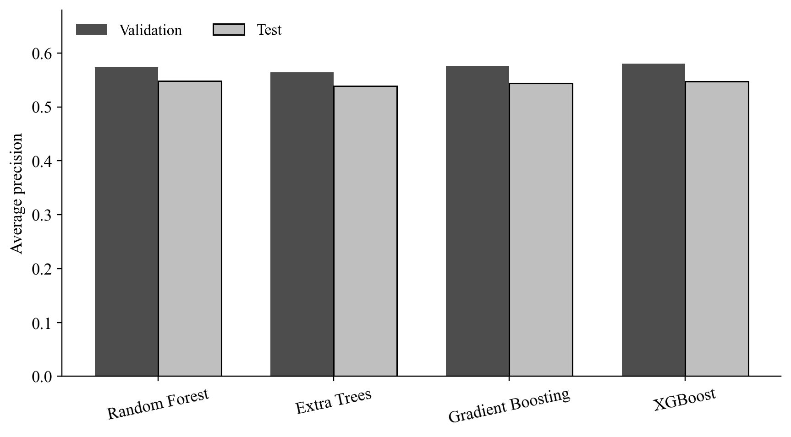
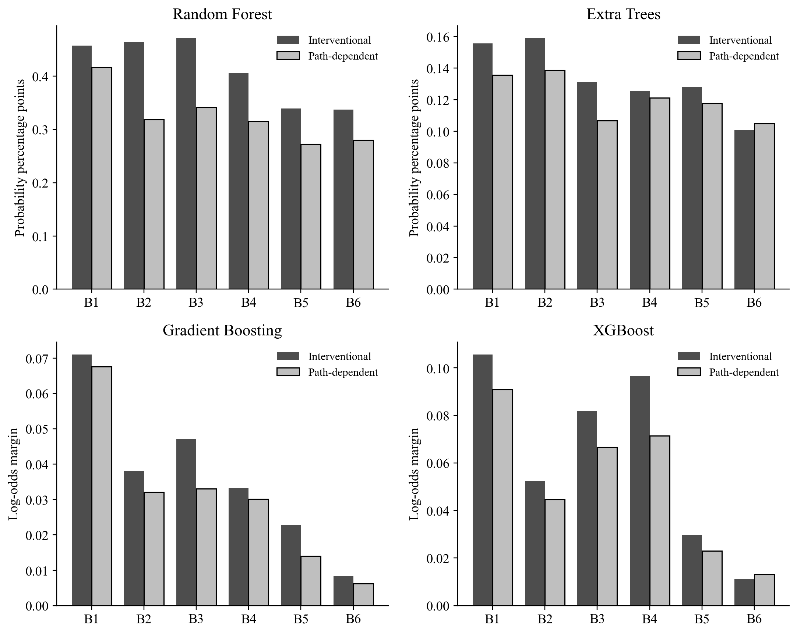
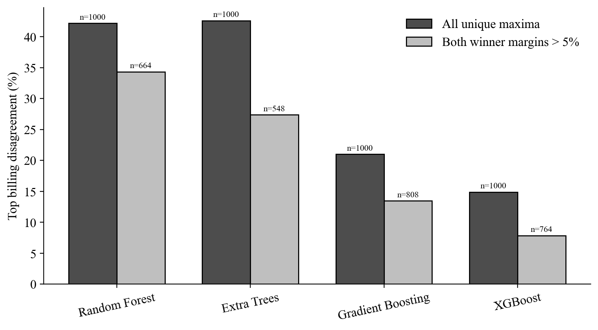
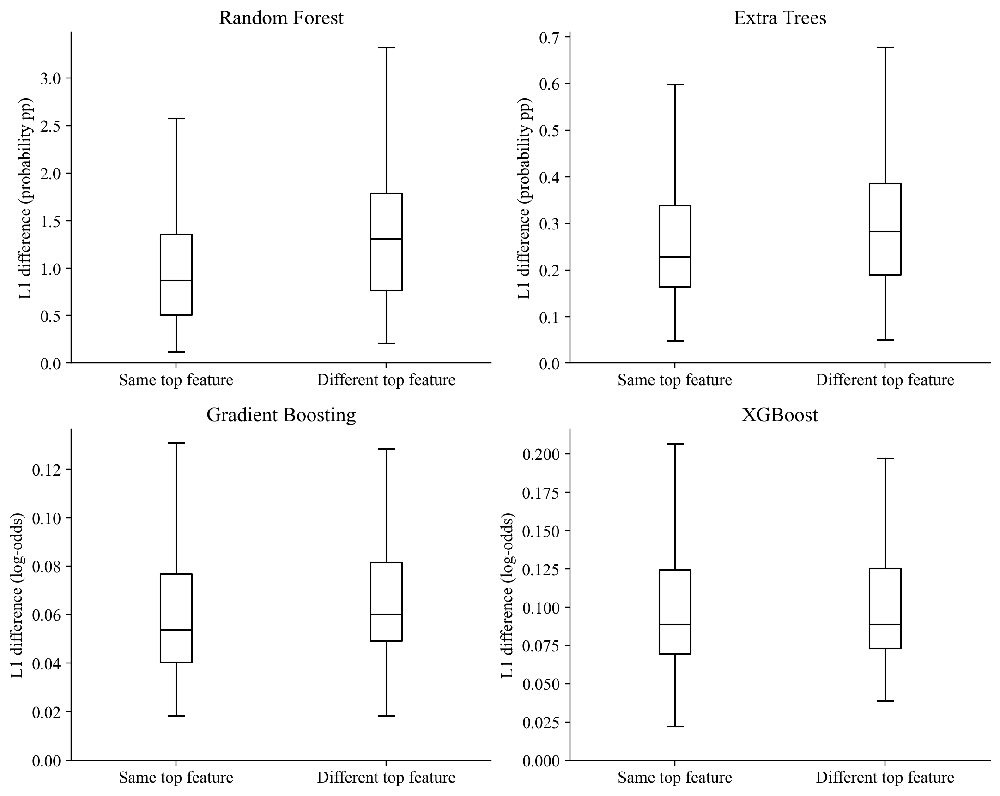
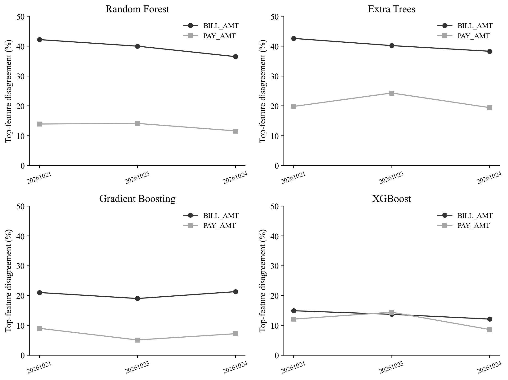

# Hasil eksperimen revisi empat model

Dataset UCI Credit Card Default dan split lama dipertahankan. Protokol ditetapkan sebelum hasil revisi, tetapi test sudah pernah dilihat; hasil ini analisis pengembangan, bukan konfirmasi pada holdout baru.

## 1. Cakupan yang selesai

Empat keluarga, tiga konfigurasi per keluarga, tiga seed training (42/17/73), 1.000 observasi test tetap. Seed 42 memakai tiga background 100 train; dua seed lain memakai background awal tetap. Pilot dan additivity diperiksa setiap model. Hasil lama tidak ditimpa. Dua background tambahan RF seed 42 menggunakan artefak yang sudah direproduksi; lihat reuse_provenance.json.

## 2. Performa prediksi

| Model | AP validation | AP test | ROC-AUC test | F1 test | Recall test | Brier test |
| --- | --- | --- | --- | --- | --- | --- |
| Random Forest | 0.5731 | 0.5481 | 0.7741 | 0.5179 | 0.5770 | 0.1361 |
| Extra Trees | 0.5640 | 0.5387 | 0.7650 | 0.5139 | 0.5527 | 0.1372 |
| Gradient Boosting | 0.5757 | 0.5441 | 0.7716 | 0.5193 | 0.5345 | 0.1356 |
| XGBoost | 0.5805 | 0.5472 | 0.7749 | 0.5303 | 0.5444 | 0.1351 |

Model utama menurut AP validation adalah **XGBoost**. Model utama tidak dipilih dari AP test. Threshold tiap model berasal dari F1 validation; Brier bukan ukuran kalibrasi murni. Semua model tetap disertakan pada analisis atribusi.

## 3. Dua mode pada setiap model

| family | group | spearman | n_valid | disagreement_rate | mean_L1_difference | relative_L1 | units |
| --- | --- | --- | --- | --- | --- | --- | --- |
| Random Forest | BILL_AMT | 0.7714 | 1000 | 0.4220 | 0.0116 | 0.0883 | probability |
| Random Forest | PAY_AMT | 0.9429 | 1000 | 0.1390 | 0.0092 | 0.0698 | probability |
| Extra Trees | BILL_AMT | 0.7714 | 1000 | 0.4260 | 0.0030 | 0.0226 | probability |
| Extra Trees | PAY_AMT | 0.6000 | 1000 | 0.1980 | 0.0016 | 0.0116 | probability |
| Gradient Boosting | BILL_AMT | 1.0000 | 1000 | 0.2100 | 0.0643 | 0.0817 | log_odds_margin |
| Gradient Boosting | PAY_AMT | 1.0000 | 1000 | 0.0900 | 0.0627 | 0.0797 | log_odds_margin |
| XGBoost | BILL_AMT | 1.0000 | 1000 | 0.1490 | 0.1051 | 0.1121 | log_odds_margin |
| XGBoost | PAY_AMT | 1.0000 | 1000 | 0.1210 | 0.1067 | 0.1138 | log_odds_margin |

Raw Random Forest/Extra Trees berupa probabilitas; raw kedua boosting berupa log-odds/margin. Selisih mentah tidak sebanding lintas satuan. Relative L1 memakai mean abs(raw output - baseline path) sebagai penyebut per fitted model, tetapi tetap tidak invariant terhadap link nonlinear. Ranking dan persentase ketidaksepakatan juga bergantung pada model/fungsi output.

B1-B6 pada grafik berarti BILL_AMT1-BILL_AMT6. Skala setiap panel mengikuti unit modelnya.

## 4. Kasus hampir seri

Margin = (atribusi absolut pertama - kedua)/(pertama + kedua). Subset robust mensyaratkan margin >0,05 pada kedua mode. Ambang ditetapkan sebelum analisis; hasil 0,01 dan 0,10 tetap tersedia di tabel lengkap. Denominator subset berubah sehingga angka subset tidak boleh dianggap langsung sebagai pengurangan error pada seluruh nasabah.

| family | margin_cutoff | n_valid | n_disagreement | disagreement_rate |
| --- | --- | --- | --- | --- |
| Random Forest | 0.0000 | 1000 | 422 | 0.4220 |
| Random Forest | 0.0500 | 664 | 228 | 0.3434 |
| Extra Trees | 0.0000 | 1000 | 426 | 0.4260 |
| Extra Trees | 0.0500 | 548 | 150 | 0.2737 |
| Gradient Boosting | 0.0000 | 1000 | 210 | 0.2100 |
| Gradient Boosting | 0.0500 | 808 | 109 | 0.1349 |
| XGBoost | 0.0000 | 1000 | 149 | 0.1490 |
| XGBoost | 0.0500 | 764 | 60 | 0.0785 |

Besar perbedaan juga dibandingkan antara kasus dengan pemenang sama dan berbeda. Seluruh ambang margin tersedia di magnitude_by_agreement.csv; plot berikut menampilkan baseline utama, tanpa outlier pada tampilan boxplot (data tidak dihapus).

RF dan Extra Trees sama-sama menunjukkan ketidaksepakatan sekitar 42%, tetapi mean L1 enam tagihannya masing-masing 1.1591 dan 0.3041 poin persentase probabilitas. Kesamaan tingkat pergantian pemenang tidak berarti besar perubahan atribusinya sama. Pada kedua boosting, distribusi L1 kasus dengan pemenang sama/berbeda juga dapat tumpang tindih; perubahan ranking bukan pengganti ukuran magnitudo.

## 5. Background dan seed

| family | seed | max_probability_difference_from_seed42 | test_predictions_equal_to_seed42_at_1e-12 | billing_disagreement | billing_spearman |
| --- | --- | --- | --- | --- | --- |
| random_forest | 42 | 0.0000 | True | 0.4220 | 0.7714 |
| random_forest | 17 | 0.0715 | False | 0.4610 | 0.9429 |
| random_forest | 73 | 0.0746 | False | 0.4220 | 1.0000 |
| extra_trees | 42 | 0.0000 | True | 0.4260 | 0.7714 |
| extra_trees | 17 | 0.0510 | False | 0.4160 | 0.8286 |
| extra_trees | 73 | 0.0654 | False | 0.4190 | 0.7714 |
| gradient_boosting | 42 | 0.0000 | True | 0.2100 | 1.0000 |
| gradient_boosting | 17 | 0.0207 | False | 0.2110 | 1.0000 |
| gradient_boosting | 73 | 0.0149 | False | 0.2100 | 1.0000 |
| xgboost | 42 | 0.0000 | True | 0.1490 | 1.0000 |
| xgboost | 17 | 0.1276 | False | 0.1490 | 1.0000 |
| xgboost | 73 | 0.1900 | False | 0.1710 | 1.0000 |

Tiga seed adalah pemeriksaan deskriptif, bukan 100 replikasi independen. Gradient Boosting dengan subsample=1 dan semua fitur dapat menghasilkan fungsi yang sama pada seed berbeda; kolom kesamaan prediksi test di atas harus dibaca sebelum menyebutnya variasi model yang independen. Kesamaan pada test saja tidak membuktikan fungsi sama pada seluruh input. Tidak mengklaim menangkap distribusi ketidakpastian populasi.

## 6. Kelompok fitur dan batas interpretasi

| group | method | min | max | mean |
| --- | --- | --- | --- | --- |
| BILL_AMT | pearson | 0.7963 | 0.9501 | 0.8816 |
| BILL_AMT | spearman | 0.7324 | 0.9091 | 0.8406 |
| PAY_AMT | pearson | 0.1149 | 0.3277 | 0.2037 |
| PAY_AMT | spearman | 0.4566 | 0.5498 | 0.5127 |

PAY_AMT memiliki korelasi Pearson lebih rendah pada train, tetapi Spearman tetap sekitar 0,46-0,55. Perbandingan kelompok tidak mengisolasi efek korelasi karena distribusi, relevansi prediktif, dan penggunaan split juga berbeda. Pemain TreeSHAP tetap kolom encoded; penjumlahan signed indikator untuk laporan source-level bukan permainan grouped Shapley baru. Masking kategori dapat membentuk kombinasi indikator yang tidak terjadi secara alami.

## 7. Posisi terhadap paper 2025

Empat model dan analisis margin memperluas dimensi pemeriksaan, tetapi tidak berarti penelitian secara keseluruhan mengungguli jurnal. Lin-Wang meneliti 100 seed XGBoost; kita hanya tiga. García-Céspedes dkk. sudah membahas dua mode dan distribusi portfolio; detail full text belum dapat diaudit lengkap. Lihat literature_positioning.md untuk bukti dan batas akses. Studi kita diposisikan sebagai pengembangan empiris terfokus; klaim novelty belum final.

## 8. Keterbatasan dan pekerjaan naskah

Satu dataset, satu split, test pernah dilihat, pencarian konfigurasi terbatas, hanya tiga seed dan ukuran background 100, tanpa klaim kausal maupun uji signifikansi populasi. Kalibrasi tidak diuji dengan reliability curve. Background adalah sampel dari train yang sama; belum ada uji pergeseran portfolio/populasi. Tidak ada eksperimen manipulasi korelasi atau enumerasi Shapley acuan. Google Docs dan panduan konsultasi historis belum diubah.

Tabel lengkap: selection_validation.csv, predictive_metrics.csv, attribution_summary.csv, feature_comparison.csv, source_importance.csv, seed_sensitivity.csv, pilot_checks.csv. Unit, membership, baseline, checksum, dan versi ada pada manifest serta model_manifest masing-masing run.
