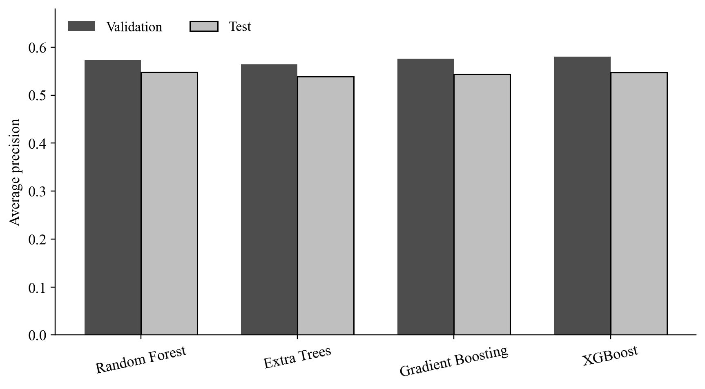
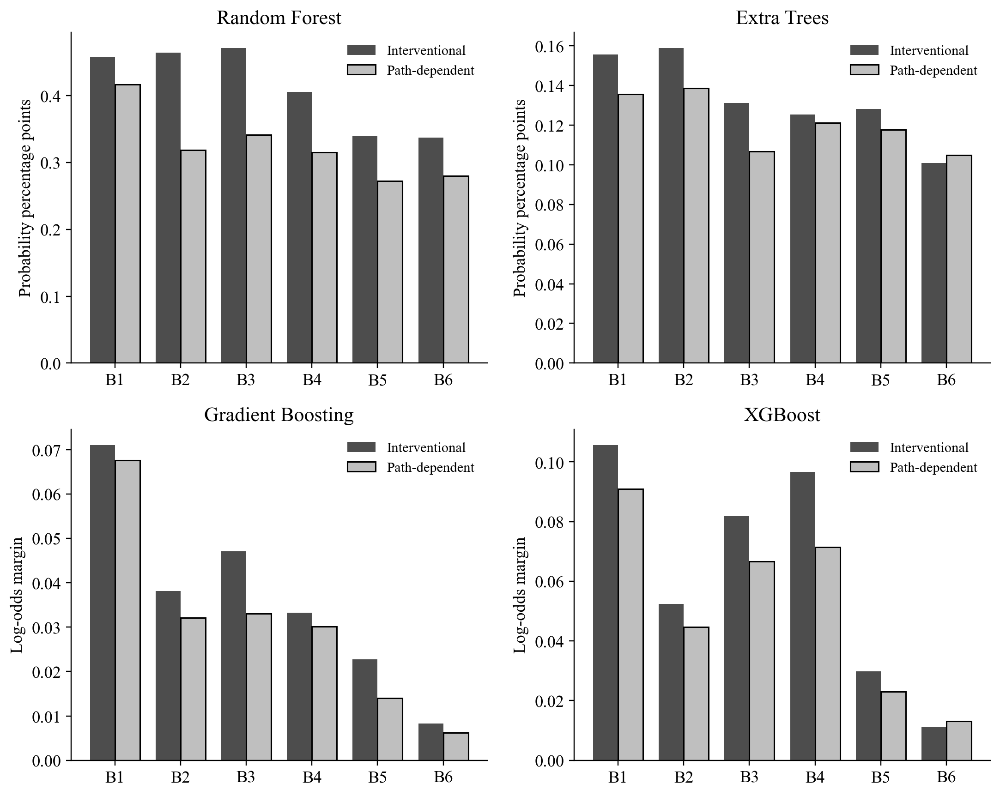
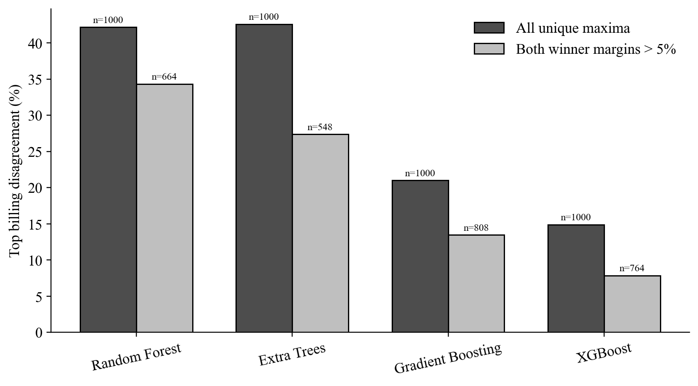
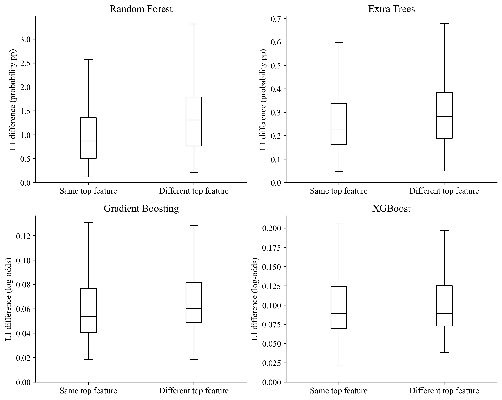
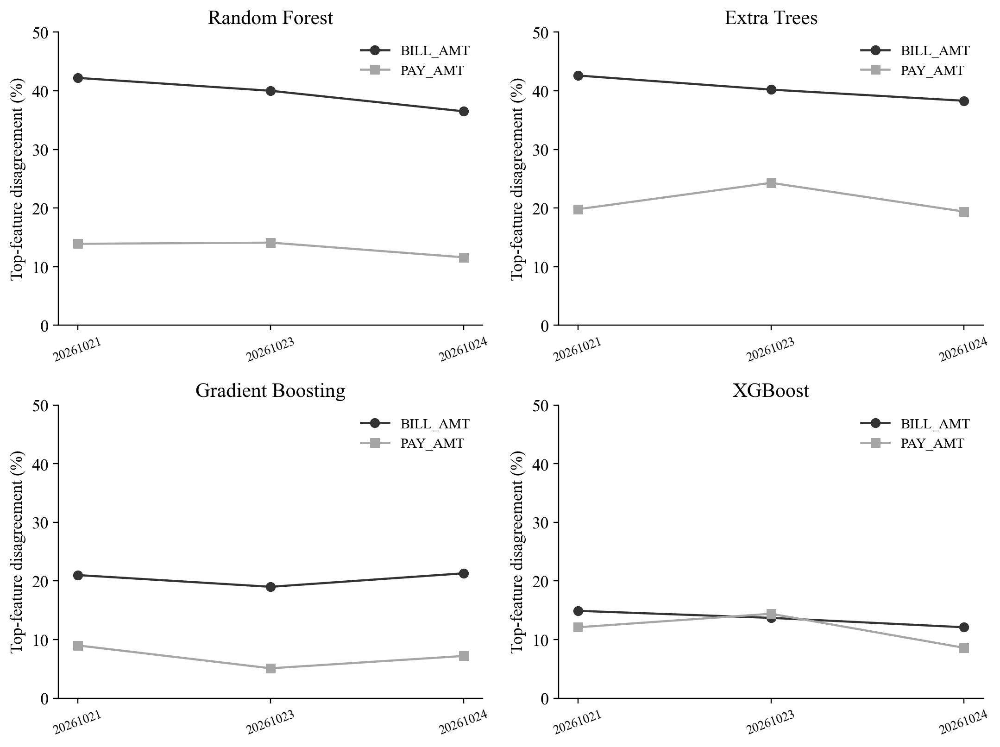

# Mode Sensitivity of TreeSHAP Attributions across Tree-Based Credit Default Models

## Status of these sections

These are revised local methods and results sections. They supplement the existing dataset/preprocessing section and require citation/numbering integration before submission. The original consultation document and Google Doc have not been edited. The analysis is exploratory development following earlier examination of the same test partition.

## Abstract draft

Feature-attribution conclusions can depend on the reference assumptions used by explanation algorithms. This study compares interventional and tree-path-dependent TreeSHAP on the UCI credit-card-default dataset using four tree-model families: Random Forest, Extra Trees, Gradient Boosting, and XGBoost. Models share a fixed group-aware partition and encoded predictor schema. Three configurations per family are compared by validation average precision, and classification thresholds are selected by validation F1. Attribution analysis uses 1,000 fixed test observations, three training backgrounds for the primary seed, and two additional training seeds with a fixed background. The analysis focuses on correlated billing features and assesses global importance, individual top-feature agreement, winner margins, and paired attribution differences. For the primary seed and background, top-billing-feature disagreement spans 14.9% to 42.6% across model families. Model-specific output units, differing baselines, prior test exposure, and the limited seed/background design constrain interpretation. The study evaluates sensitivity of model explanations and does not identify causal effects or establish an attribution method as universally correct.

## 1. Research questions and scope

The study asks whether two TreeSHAP settings lead to different billing-feature allocations within the same fitted predictor, whether similar global rankings coexist with different individual leading features, and whether disagreements persist when near-tied winners are examined separately. Comparisons across model families are descriptive. The fitted function changes across families, so between-family differences cannot be assigned solely to explainer behavior.

Six BILL_AMT variables form the primary group. Six PAY_AMT variables form a secondary comparison with training-set correlations recorded before interpretation. Demographic and repayment-status indicators remain in the predictive models. No correlated billing feature is removed. A difference between the two feature groups is not interpreted as the causal effect of correlation because relevance, distributions, and model usage also differ.

## 2. Predictive model development

All models use the existing 18,005/5,997/5,998 training/validation/test partition. Exact mapped predictor profiles remain within one partition, and the fitted training-only encoder provides the same 89 input columns. Model families receive three candidate configurations each, which is an equal number of configurations rather than an equal computational budget or an exhaustive optimization.

Random Forest and Extra Trees use 300 trees, minimum leaf size 5, and square-root feature sampling. Depth candidates are 8, 12, and unrestricted. Random Forest uses bootstrap sampling; Extra Trees does not. Gradient Boosting uses 200 stages, learning rate 0.05, minimum leaf size 5, and depths 2/3/4, with subsample 1. XGBoost uses 300 estimators, learning rate 0.05, depths 2/3/4, row and column sampling fractions 0.8, L2 regularization 1, histogram tree construction, and the binary-logistic objective. No class resampling or class weighting is applied.

Candidate selection uses the highest validation average precision at training seed 42. Exact ties retain the first candidate. Within each family, selected hyperparameters are frozen for seeds 17 and 73. A separate classification threshold for each fitted model maximizes validation F1; tied maxima select the higher threshold. Models are not refitted on combined training and validation data. All four families are included in explanation analysis regardless of which has the highest predictive score.

Performance reporting includes AP, ROC-AUC, precision, recall, F1, accuracy, Brier score, and log loss. AP and ROC-AUC evaluate continuous scores; threshold-based metrics evaluate binary decisions. Brier score is not interpreted as a pure calibration measure. No business-cost-optimal threshold is claimed.

## 3. Paired TreeSHAP protocol

The evaluation sample contains the same 1,000 test observations used in the original experiment, selected without replacement using seed 20261022. Backgrounds contain 100 training observations each, sampled with seeds 20261021, 20261023, and 20261024. The primary training seed is evaluated with all three backgrounds. The additional model seeds use only the first background, keeping background and model randomness separate rather than running a complete factorial design.

Both explanation modes use the same fitted predictor, observations, encoded column order, and raw output within each comparison. Calculations use approximate=False. Random Forest and Extra Trees raw outputs are default probabilities. Gradient Boosting and XGBoost raw outputs are log-odds margins. Additive reconstruction is compared against the corresponding native prediction function; probability magnitudes and margin magnitudes are not directly pooled. Sigmoid transformations of individual margin attributions are not used to construct probability attributions.

A 20-observation implementation pilot precedes each model's main explanation. Absolute reconstruction tolerances are 1e-6 for the scikit-learn families and 1e-5 for XGBoost. The latter was documented after a 300-tree technical pilot showed approximately 1-2e-6 discrepancies against native float32 margins. Actual errors and settings are retained. Two additional primary-RF background results reuse verified historical arrays after full validation/test prediction identity and parameter equality were established.

## 4. Attribution measures

Global feature importance is the sample mean of absolute SHAP values. For each observation, the top billing feature maximizes absolute attribution among the six billing columns. Tied maxima within absolute tolerance 1e-12 in either mode are excluded from the agreement denominator. Spearman correlation and Kendall tau-b summarize agreement between the six-feature global rankings; they are descriptive summaries rather than population significance tests.

For the two largest absolute attributions a1 and a2, the winner margin is (a1-a2)/(a1+a2), set to zero for a denominator at most 1e-12. Disagreement is reported for all unique maxima and for subsets requiring both modes' margins to exceed 0.01, 0.05, and 0.10. All thresholds were specified in the protocol, and changing subset denominators are reported.

Paired magnitudes include the mean sum of absolute feature differences and the mean absolute difference between signed group sums. A relative L1 index divides the former by the mean absolute model raw output centered on the path baseline. This index is not invariant under nonlinear link transformations. Signed sums over the billing group are aggregates of individual-player attributions, not Shapley values of a new grouped-player game.

For whole-model reporting, signed one-hot attributions are summed to each original variable before taking mean absolute values. This reporting aggregation does not redefine the underlying encoded-input game. Interventional masking of encoded inputs may create combinations outside natural categorical patterns, which remains an interpretation limitation.

## 5. Predictive results

| Model | AP validation | AP test | ROC-AUC test | F1 test | Recall test | Brier test |
| --- | --- | --- | --- | --- | --- | --- |
| Random Forest | 0.5731 | 0.5481 | 0.7741 | 0.5179 | 0.5770 | 0.1361 |
| Extra Trees | 0.5640 | 0.5387 | 0.7650 | 0.5139 | 0.5527 | 0.1372 |
| Gradient Boosting | 0.5757 | 0.5441 | 0.7716 | 0.5193 | 0.5345 | 0.1356 |
| XGBoost | 0.5805 | 0.5472 | 0.7749 | 0.5303 | 0.5444 | 0.1351 |

The primary family selected by validation AP is **XGBoost**. Test performance is reported after selection and is not used to choose the family. These results are not directly comparable with published metrics obtained using other splits, encodings, sampling policies, or tuning budgets.

## 6. Attribution results

Primary seed/background results for the billing group:

| family | n_valid | n_disagreement | disagreement_rate | spearman | mean_L1_difference | units |
| --- | --- | --- | --- | --- | --- | --- |
| random_forest | 1000 | 422 | 0.4220 | 0.7714 | 0.0116 | probability |
| extra_trees | 1000 | 426 | 0.4260 | 0.7714 | 0.0030 | probability |
| gradient_boosting | 1000 | 210 | 0.2100 | 1.0000 | 0.0643 | log_odds_margin |
| xgboost | 1000 | 149 | 0.1490 | 1.0000 | 0.1051 | log_odds_margin |

Raw magnitudes retain their model-specific units. Differences in baselines necessarily lead to compensating changes in total attribution when both modes reconstruct the same output. Billing-group differences therefore cannot be described solely as redistribution among months with an unchanged group total.

Winner-margin subsets:

| family | margin_cutoff | n_valid | n_disagreement | disagreement_rate |
| --- | --- | --- | --- | --- |
| random_forest | 0.0000 | 1000 | 422 | 0.4220 |
| random_forest | 0.0500 | 664 | 228 | 0.3434 |
| extra_trees | 0.0000 | 1000 | 426 | 0.4260 |
| extra_trees | 0.0500 | 548 | 150 | 0.2737 |
| gradient_boosting | 0.0000 | 1000 | 210 | 0.2100 |
| gradient_boosting | 0.0500 | 808 | 109 | 0.1349 |
| xgboost | 0.0000 | 1000 | 149 | 0.1490 |
| xgboost | 0.0500 | 764 | 60 | 0.0785 |

The subset analysis assesses whether disagreement coexists with more clearly separated local winners. It does not convert disagreement into an explanation error rate or show that excluded cases are unimportant. Magnitudes and changed denominators must be considered together.

The two forest families have similar top-feature disagreement rates but different L1 magnitudes in the same probability units. Ranking switches and attribution magnitudes should therefore be reported separately. The following plot compares the distributions for unchanged and changed winners in the primary setting; outliers are hidden only in the display, not removed from the data.

## 7. Background and training-seed sensitivity

| family | seed | max_probability_difference_from_seed42 | test_predictions_equal_to_seed42_at_1e-12 | billing_disagreement | billing_spearman |
| --- | --- | --- | --- | --- | --- |
| random_forest | 42 | 0.0000 | True | 0.4220 | 0.7714 |
| random_forest | 17 | 0.0715 | False | 0.4610 | 0.9429 |
| random_forest | 73 | 0.0746 | False | 0.4220 | 1.0000 |
| extra_trees | 42 | 0.0000 | True | 0.4260 | 0.7714 |
| extra_trees | 17 | 0.0510 | False | 0.4160 | 0.8286 |
| extra_trees | 73 | 0.0654 | False | 0.4190 | 0.7714 |
| gradient_boosting | 42 | 0.0000 | True | 0.2100 | 1.0000 |
| gradient_boosting | 17 | 0.0207 | False | 0.2110 | 1.0000 |
| gradient_boosting | 73 | 0.0149 | False | 0.2100 | 1.0000 |
| xgboost | 42 | 0.0000 | True | 0.1490 | 1.0000 |
| xgboost | 17 | 0.1276 | False | 0.1490 | 1.0000 |
| xgboost | 73 | 0.1900 | False | 0.1710 | 1.0000 |

The seed check is descriptive and limited to three runs. The seed table checks equality of test prediction vectors against seed 42. Identical vectors, if observed, are not treated as evidence of additional varied fits; equality on this sample alone would not establish equality of the functions over all possible inputs. Background sizes remain fixed at 100, and all are sampled from the same training partition; this is not an evaluation under a new population or externally shifted portfolio. The additional seeds do not have all three backgrounds, so no general model-seed-by-background interaction is estimated.

## 8. Relation to earlier work and limitations

Comparisons between interventional and path-dependent explanations and sensitivity to portfolio reference distributions already appear in García-Céspedes, Alias-Carrascosa, and Moreno (2025). Lin and Wang (2025) study training-seed stability using 100 XGBoost fits on the same UCI credit dataset. Neither use of TreeSHAP, reuse of this dataset, nor seed repetition is claimed as a new contribution. The present empirical focus combines model-family comparisons, global/local agreement, and winner-margin diagnostics; a claim of first use requires a broader literature audit than performed here.

One dataset, one previously examined test partition, limited hyperparameter search, three training seeds, and three fixed-size backgrounds limit generalization. The experiment does not manipulate correlation, establish causal effects, evaluate a population-level significance hypothesis, or validate Shapley values against exhaustive enumeration on a small tree. Numerical additivity verifies consistency with model outputs and does not prove substantive or causal correctness.

## References for these sections

- García-Céspedes, R., Alias-Carrascosa, F. J., and Moreno, M. (2025). On Machine Learning models explainability in the banking sector: the case of SHAP. https://doi.org/10.1080/01605682.2025.2485263. Publisher abstract/metadata and accessible notes checked; complete full text not audited.
- Lin, L., and Wang, Y. (2025). SHAP Stability in Credit Risk Management: A Case Study in Credit Card Default Model. https://doi.org/10.3390/risks13120238. Accessible publisher-method excerpts checked.
- SHAP developers. TreeExplainer documentation. https://shap.readthedocs.io/en/latest/generated/shap.TreeExplainer.html. Runtime versions are recorded in manifest.json.
- scikit-learn developers. GradientBoostingClassifier 1.7.2. https://scikit-learn.org/1.7/modules/generated/sklearn.ensemble.GradientBoostingClassifier.html.
- XGBoost developers. Parameter documentation. https://xgboost.readthedocs.io/en/stable/parameter.html.

Full numerical tables, per-observation results, software versions, membership, models, baselines, and protocol amendments are retained in this experiment directory.
