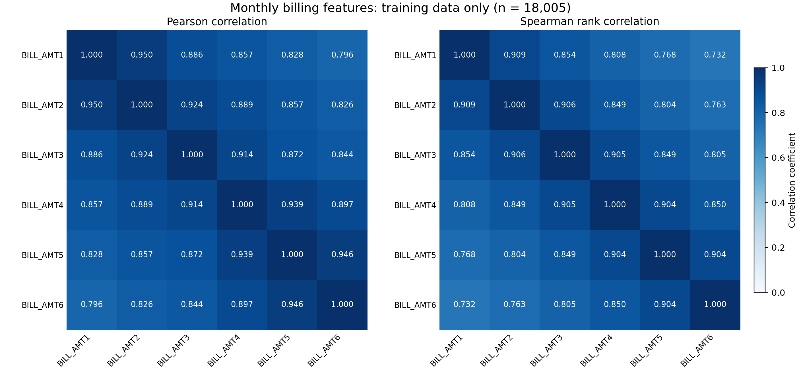
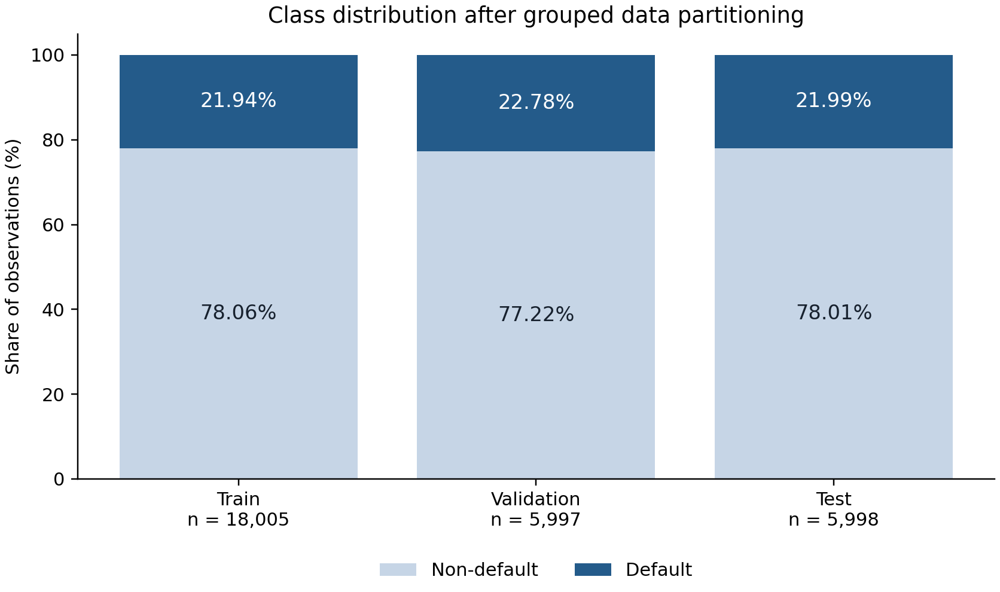

# Dataset and Preprocessing

## Data source and outcome

The study uses the Default of Credit Card Clients dataset, originally distributed by the UCI Machine Learning Repository and obtained through its Kaggle mirror [D1,D2]. The local dataset contains 30,000 customer records, 23 candidate predictors, one identifier, and one binary outcome. The six-month histories cover April-September 2005. Financial amounts are denominated in New Taiwan dollars. The target indicates default payment in the following month. There are 6,636 default observations (22.12%) and 23,364 non-default observations (77.88%). This is a customer-level historical classification dataset; ID order is not a temporal observation sequence.

## Quality audit and prespecified transformations

The original CSV was preserved and verified against a raw snapshot using SHA-256. The audit found no missing or nonfinite values. ID was excluded from the predictor matrix, and the outcome was stored separately. EDUCATION codes 0, 5, and 6 were mapped to a single unknown category, while code 4 remained others. This policy affected 345 observations, of which 331 changed numeric code because 14 were already coded 0. MARRIAGE code 0 was retained as a separate unknown category. Negative billing amounts, zero payments, and observed repayment-status categories were retained. The interpretation of additional repayment-status codes was documented using supplementary literature rather than inferred from their numeric sign [D3]. No observations were removed, no outlier clipping was performed, and no class resampling was applied.

| Item | Treatment | Rationale |
| --- | --- | --- |
| ID | Excluded from model inputs; retained in metadata | Identifier is not a substantive predictor |
| default.payment.next.month | Separated as target | Prevent target leakage |
| EDUCATION | Codes 0/5/6 merged as unknown (code 0); 4 retained as others | Conservative treatment of insufficiently documented categories |
| MARRIAGE | Code 0 retained as unknown | Do not invent a specific status |
| PAY status features | Retained as categorical, including -2/-1/0 | Distinct recorded states are not missing values |
| Billing/payment amounts | Retained, including negative bills and zero payments | No verified basis for automatic deletion |
| Repeated profiles | Retained; same feature profile assigned to one partition | Limit identical-profile overlap without replacing observed outcomes |
| All rows | Retained; no imputation, scaling, clipping, or resampling | Preserve observations and limit extra experimental factors |

Table 1. Prespecified data preparation decisions.

## Group-aware partitioning

Customer profiles were grouped by exact equality of the 23 predictors after deterministic category mapping, excluding ID and outcome. There were 29,944 distinct profiles; 108 records belonged to 52 repeated-profile groups. Groups with different observed outcomes were retained without relabeling. A five-fold StratifiedGroupKFold partition was generated using shuffle=True and random_state=20261020. Fold 0 was assigned to test, fold 1 to validation, and folds 2-4 to training, targeting a 60:20:20 partition [D4]. Fold allocation was fixed without model-performance-based selection. Identical mapped profiles did not cross partitions. This grouping reduces identical-profile overlap but does not establish independence with respect to unobserved customer relationships.

| Partition | Observations | Non-default | Default | Default share |
| --- | --- | --- | --- | --- |
| Train | 18005 | 14054 | 3951 | 21.94% |
| Validation | 5997 | 4631 | 1366 | 22.78% |
| Test | 5998 | 4679 | 1319 | 21.99% |

Table 2. Actual partition sizes and class composition.

## Encoding

The nine categorical predictors were one-hot encoded with no reference category dropped. The encoder was fitted only on the 18,005 training observations and then applied unchanged to validation and test, using handle_unknown='ignore' [D5]. The 14 numerical predictors were passed through without scaling. The resulting matrices contain 89 inputs in the same order across partitions. The six BILL_AMT features remain individual numerical columns. A mapping from encoded columns to original variables was saved for subsequent source-feature-level explanation. No unseen categorical values were found in validation or test. Held-out data were not used to refit the encoder.

## Exploratory correlation analysis

Correlation analysis used training observations only. Pairwise Pearson correlations among BILL_AMT1-BILL_AMT6 ranged from 0.796 to 0.950, while Spearman correlations ranged from 0.732 to 0.909. For BILL_AMT1 and BILL_AMT2, the corresponding coefficients were 0.950 and 0.909. These descriptive results support examining attribution allocation among strongly associated billing features. They do not establish causal relationships or show that billing features dominate the fitted predictor. No correlated billing feature was removed because these features are the object of the planned TreeSHAP comparison.

Figure 1. Pearson and Spearman correlations among six monthly billing features in the training partition.

Figure 2. Class composition after group-aware partitioning. Labels report within-partition percentages.

## Reproducibility and scope

Raw checksum, split membership, software versions, feature ordering, category mapping, fitted preprocessor, and validation checks were recorded. Preparation of the dataset does not establish model performance or TreeSHAP findings; these require subsequent modeling and explanation experiments. All checks reported here concern data preparation.

## References for this section

[D1] I. Yeh, Default of Credit Card Clients, UCI Machine Learning Repository, 2009. https://doi.org/10.24432/C55S3H

[D2] Kaggle mirror: https://www.kaggle.com/datasets/uciml/default-of-credit-card-clients-dataset

[D3] L. Lin and Y. Wang, SHAP Stability in Credit Risk Management: A Case Study in Credit Card Default Model, 2025. https://doi.org/10.3390/risks13120238 (supplementary code interpretations checked against the preprint: https://arxiv.org/pdf/2508.01851).

[D4] scikit-learn 1.7, StratifiedGroupKFold documentation. https://scikit-learn.org/1.7/modules/generated/sklearn.model_selection.StratifiedGroupKFold.html

[D5] scikit-learn 1.7, OneHotEncoder documentation. https://scikit-learn.org/1.7/modules/generated/sklearn.preprocessing.OneHotEncoder.html
