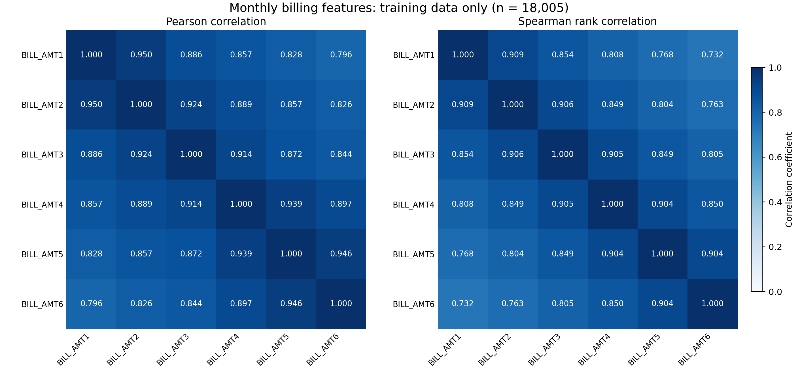

# Dataset and Preprocessing

## A. Dataset Description

This study uses the Default of Credit Card Clients dataset from the UCI Machine Learning Repository, obtained through its Kaggle mirror [10], [11]. The dataset contains 30,000 customer records, 23 predictors, one identifier, and one binary outcome. The predictors describe demographic characteristics, credit limits, repayment status, billing amounts, and previous payments. The financial histories cover April-September 2005, and monetary values are expressed in New Taiwan dollars. Each row represents a customer, rather than a separate monthly observation.

The outcome, `default.payment.next.month`, indicates default payment in the following month, with 1 representing default and 0 representing non-default. The dataset contains 6,636 default observations (22.12%) and 23,364 non-default observations (77.88%). The identifier was retained for record tracking but excluded from the predictor matrix. The outcome was stored separately from the predictors.

## B. Data Quality Assessment and Preparation

The original data were preserved, and a raw snapshot was verified using SHA-256. The audit found no missing or nonfinite values. Preparation followed documented rules established before model fitting. EDUCATION codes 0, 5, and 6 were combined into an unknown category, while code 4 remained others. This category contained 345 observations; 331 records changed numeric code because 14 records were already coded 0. MARRIAGE code 0 was retained as a separate unknown category.

Repayment-status codes -2, -1, and 0 were retained as distinct categories, rather than treated as missing values or negative durations. Supplementary interpretations of the repayment-status codes were consulted in Lin and Wang [7]. Negative billing amounts and zero payment amounts were also retained because the audit did not establish that these observations were erroneous. No observations were removed, and no imputation, outlier clipping, scaling, or class resampling was performed.

**Table 1. Data preparation decisions.**

| Variable or issue | Treatment |
|---|---|
| ID | Excluded from predictors; retained for record tracking |
| Outcome | Stored separately as the binary target |
| EDUCATION | Codes 0, 5, and 6 combined as unknown; code 4 retained as others |
| MARRIAGE | Code 0 retained as unknown |
| Repayment status | Recorded categories retained, including -2, -1, and 0 |
| Billing and payment amounts | Negative bills and zero payments retained |
| Repeated predictor profiles | Retained and assigned to the same data partition |
| Correlated billing features | All six billing features retained for the attribution study |

## C. Group-Aware Data Partitioning

Following the predetermined category mapping, records were grouped by exact equality of the 23 predictors, excluding both the identifier and the outcome. The data contained 29,944 distinct predictor profiles, with 108 records belonging to 52 repeated-profile groups. Profiles associated with different observed outcomes were retained without relabeling.

A five-fold StratifiedGroupKFold procedure was used to approximate a 60:20:20 training, validation, and test partition while keeping each profile group within a single partition [12]. The split used shuffling with random state 20261020. Fold 0 was assigned to test, fold 1 to validation, and the remaining three folds to training. This allocation was fixed without selecting folds based on model performance. Identical mapped profiles did not appear across partitions. The procedure limits overlap of observed profiles but does not establish independence with respect to unobserved customer relationships.

**Table 2. Dataset partitions and class composition.**

| Partition | Observations | Non-default | Default | Default proportion |
|---|---:|---:|---:|---:|
| Training | 18,005 | 14,054 | 3,951 | 21.94% |
| Validation | 5,997 | 4,631 | 1,366 | 22.78% |
| Test | 5,998 | 4,679 | 1,319 | 21.99% |
| Total | 30,000 | 23,364 | 6,636 | 22.12% |

## D. Categorical Encoding

The nine categorical predictors were one-hot encoded without dropping a reference category. The encoder was fitted exclusively on the training partition and applied unchanged to validation and test. Unseen categories were configured to produce all-zero indicators for the corresponding source variable using `handle_unknown='ignore'` [13]; however, no unseen categorical values were observed in either held-out partition.

The 14 numerical predictors were retained without scaling. The final predictor matrices contained 89 columns with identical ordering across partitions. A mapping between encoded columns and their original variables was recorded to support subsequent interpretation. The six billing variables, BILL_AMT1-BILL_AMT6, remained individual numerical predictors.

## E. Training-Set Correlation Analysis

Pearson and Spearman correlations were computed using training observations only. Pairwise Pearson correlations among the six billing features ranged from 0.796 to 0.950, while Spearman correlations ranged from 0.732 to 0.909. BILL_AMT1 and BILL_AMT2 had Pearson and Spearman correlations of 0.950 and 0.909, respectively.

These findings indicate strong associations among monthly billing features and support examining how attribution is allocated among them. They do not establish causal relationships or show that billing features are the strongest predictors of default. All six billing variables were retained because their attribution allocation is the focus of the study.

**Figure 1.** Pearson and Spearman correlation matrices for BILL_AMT1-BILL_AMT6, calculated from the training partition (n = 18,005).

## F. Reproducibility

The raw-data checksum, category-mapping rules, split membership, software versions, encoded feature ordering, and fitted preprocessor were recorded. Validation checks confirmed complete record coverage, preservation of billing values, correct alignment of predictors and outcomes, and the absence of profile-group overlap across partitions. Data preparation used Python 3.12.14, pandas 3.0.1, NumPy 2.3.5, and scikit-learn 1.7.2.

## References

[7] L. Lin and Y. Wang, “SHAP Stability in Credit Risk Management: A Case Study in Credit Card Default Model,” *Risks*, vol. 13, no. 12, Art. no. 238, 2025. doi: [10.3390/risks13120238](https://doi.org/10.3390/risks13120238).

[10] I. Yeh, *Default of Credit Card Clients*, UCI Machine Learning Repository, 2009. doi: [10.24432/C55S3H](https://doi.org/10.24432/C55S3H).

[11] UCI Machine Learning, “Default of Credit Card Clients Dataset,” Kaggle. [Dataset page](https://www.kaggle.com/datasets/uciml/default-of-credit-card-clients-dataset). Accessed: Oct. 20, 2026.

[12] scikit-learn developers, “StratifiedGroupKFold,” *scikit-learn 1.7 documentation*. [Documentation](https://scikit-learn.org/1.7/modules/generated/sklearn.model_selection.StratifiedGroupKFold.html). Accessed: Oct. 20, 2026.

[13] scikit-learn developers, “OneHotEncoder,” *scikit-learn 1.7 documentation*. [Documentation](https://scikit-learn.org/1.7/modules/generated/sklearn.preprocessing.OneHotEncoder.html). Accessed: Oct. 20, 2026.
