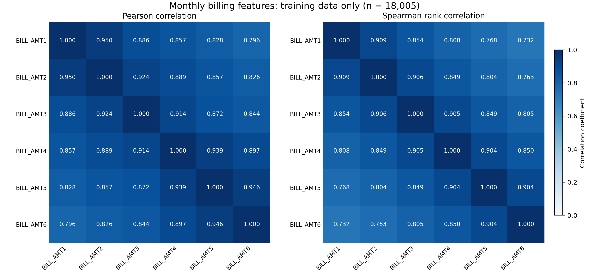
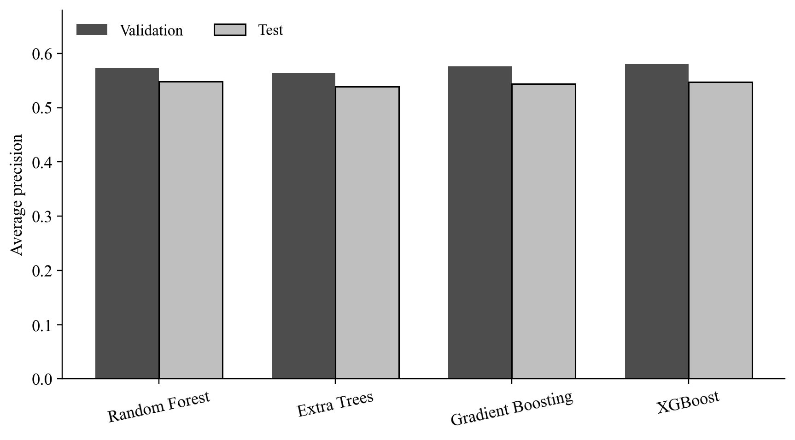
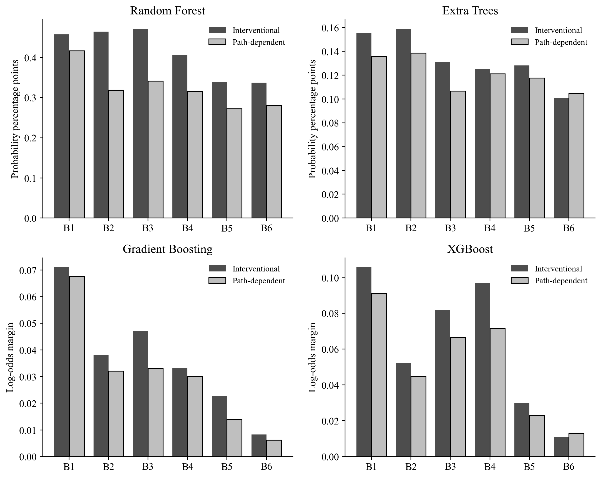
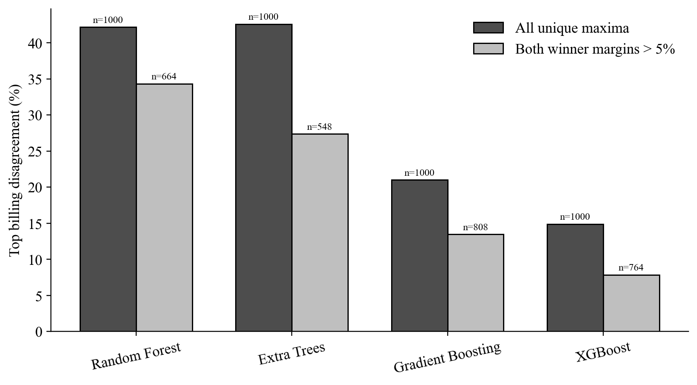
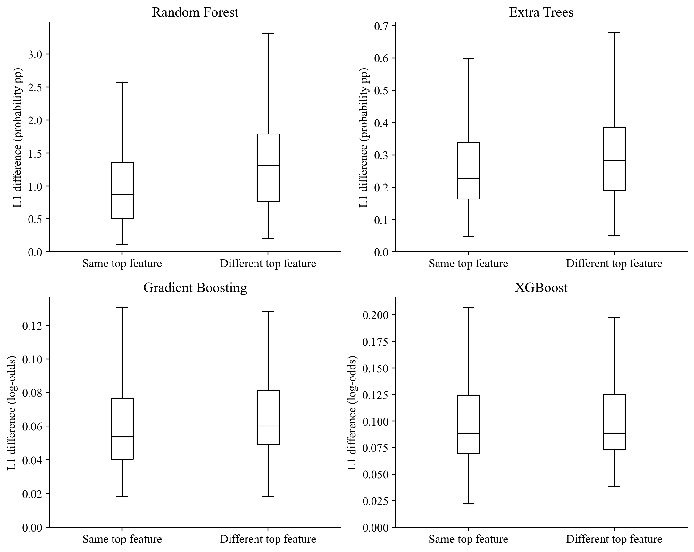
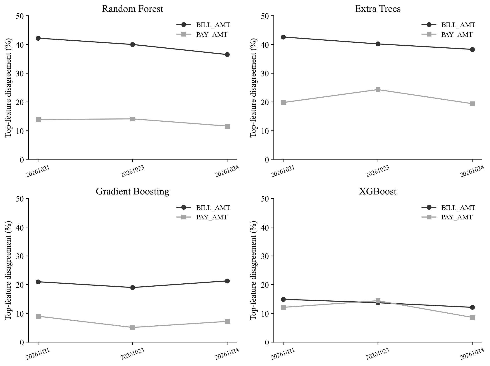

# Mode Sensitivity of TreeSHAP Attributions across Tree-Based Credit Default Models

Draft for author review - 23 October 2026.

## Abstract

Feature-attribution conclusions can depend on the reference assumptions used by explanation algorithms. This study compares interventional and tree-path-dependent TreeSHAP on the UCI credit-card-default dataset using four tree-model families: Random Forest, Extra Trees, Gradient Boosting, and XGBoost. Models share a fixed group-aware partition and encoded predictor schema. Three configurations per family are compared by validation average precision, and classification thresholds are selected by validation F1. Attribution analysis uses 1,000 fixed test observations, three training backgrounds for the primary seed, and two additional training seeds with a fixed background. The analysis focuses on correlated billing features and assesses global importance, individual top-feature agreement, winner margins, and paired attribution differences. For the primary seed and background, top-billing-feature disagreement spans 14.9% to 42.6% across model families. Model-specific output units, differing baselines, prior test exposure, and the limited seed/background design constrain interpretation. The study evaluates sensitivity of model explanations and does not identify causal effects or establish an attribution method as universally correct.

## Introduction

Credit-default classifiers use demographic characteristics, credit limits, and repayment histories to estimate a binary outcome. Predictive evaluation establishes how scores and decisions behave on held-out records, whereas attribution analysis examines how a fitted model's output is allocated among its inputs. These are separate objectives: changing an explanation setting need not change the underlying prediction.

Monthly billing features can carry overlapping information. A feature-attribution method must specify what a coalition of available features means and how the remaining features are represented. Interventional and tree-path-dependent TreeSHAP implement different reference mechanisms. Their numerical agreement therefore cannot be assumed, and disagreement alone does not identify an explanation error.

Existing credit-risk studies already compare explanation settings and examine stability under model initialization. This study is positioned as focused empirical development rather than a new attribution algorithm. Its evaluation links global billing-feature rankings, individual top-feature agreement, and the separation between the two largest local attributions. Four tree-model families provide a descriptive comparison under a common split and evaluation sample. A secondary payment-feature group is included with training-only correlation measurements; group differences do not isolate correlation as a cause.

## Related work and game-theoretic basis

Shapley values allocate the value of a cooperative game according to average marginal contributions over player orderings. For model explanations, the game is defined by a coalition-value function and a reference mechanism. Features are players; the allocated total is the model output relative to a baseline. Shapley uniqueness applies after specifying the game and does not require two different reference games to produce identical allocations (Shapley, 1953; Sundararajan and Najmi, 2020).

SHAP provides an additive attribution framework, and TreeSHAP exploits tree structure to calculate attributions under supported dependence assumptions (Lundberg and Lee, 2017; Lundberg et al., 2020). Tree-path-dependent explanations use path statistics in the fitted trees and are not treated here as general exact conditional-expectation SHAP estimates.

García-Céspedes et al. (2025) examine interventional/path-dependent explanations and sensitivity to portfolio reference distributions. Lin and Wang (2025) assess global-ranking stability over 100 XGBoost fits on the same UCI credit dataset. The present three-seed design does not match that seed coverage. Our focus adds model-family and winner-margin diagnostics to a paired empirical analysis, but first-use claims require a broader review. The accessible evidence and full-text access limitations are documented in the experiment's literature_positioning.md.

## Dataset and preprocessing

### Dataset Description

This study uses the Default of Credit Card Clients dataset from the UCI Machine Learning Repository, available through its Kaggle mirror [10], [11]. The dataset contains 30,000 customer records, 23 predictors, one identifier, and one binary outcome. The predictors describe demographic characteristics, credit limits, repayment status, billing amounts, and previous payments. The financial histories cover April-September 2005, and monetary values are expressed in New Taiwan dollars. Each row represents a customer, rather than a separate monthly observation.

The outcome, `default.payment.next.month`, indicates default payment in the following month, with 1 representing default and 0 representing non-default. The dataset contains 6,636 default observations (22.12%) and 23,364 non-default observations (77.88%). The identifier was retained for record tracking but excluded from the predictor matrix. The outcome was stored separately from the predictors.

### Data Quality Assessment and Preparation

The original data were preserved, and a raw snapshot was verified using SHA-256. The audit found no missing or nonfinite values. Preparation followed documented rules established before model fitting. EDUCATION codes 0, 5, and 6 were combined into an unknown category, while code 4 remained others. This category contained 345 observations; 331 records changed numeric code because 14 records were already coded 0. MARRIAGE code 0 was retained as a separate unknown category.

Repayment-status codes -2, -1, and 0 were retained as distinct categories, rather than treated as missing values or negative durations. Supplementary interpretations of the repayment-status codes were consulted in Lin and Wang [7]. Negative billing amounts and zero payment amounts were also retained because the audit did not establish that these observations were erroneous. No observations were removed, and no imputation, outlier clipping, scaling, or class resampling was performed.

**Table 1. Data preparation decisions.**

| Variable or issue | Treatment |
|---|---|
| ID | Excluded from predictors; retained for record tracking |
| Outcome | Stored separately as the binary target |
| EDUCATION | Codes 0, 5, and 6 combined as unknown; code 4 retained as others |
| MARRIAGE | Code 0 retained as unknown |
| Repayment status | Recorded categories retained, including -2, -1, and 0 |
| Billing and payment amounts | Negative bills and zero payments retained |
| Repeated predictor profiles | Retained and assigned to the same data partition |
| Correlated billing features | All six billing features retained for the attribution study |

### Group-Aware Data Partitioning

Following the predetermined category mapping, records were grouped by exact equality of the 23 predictors, excluding both the identifier and the outcome. The data contained 29,944 distinct predictor profiles, with 108 records belonging to 52 repeated-profile groups. Profiles associated with different observed outcomes were retained without relabeling.

A five-fold StratifiedGroupKFold procedure was used to approximate a 60:20:20 training, validation, and test partition while keeping each profile group within a single partition [12]. The split used shuffling with random state 20261020. Fold 0 was assigned to test, fold 1 to validation, and the remaining three folds to training. This allocation was fixed without selecting folds based on model performance. Identical mapped profiles did not appear across partitions. The procedure limits overlap of observed profiles but does not establish independence with respect to unobserved customer relationships.

**Table 2. Dataset partitions and class composition.**

| Partition | Observations | Non-default | Default | Default proportion |
|---|---:|---:|---:|---:|
| Training | 18,005 | 14,054 | 3,951 | 21.94% |
| Validation | 5,997 | 4,631 | 1,366 | 22.78% |
| Test | 5,998 | 4,679 | 1,319 | 21.99% |
| Total | 30,000 | 23,364 | 6,636 | 22.12% |

### Categorical Encoding

The nine categorical predictors were one-hot encoded without dropping a reference category. The encoder was fitted exclusively on the training partition and applied unchanged to validation and test. Unseen categories were configured to produce all-zero indicators for the corresponding source variable using `handle_unknown='ignore'` [13]; however, no unseen categorical values were observed in either held-out partition.

The 14 numerical predictors were retained without scaling. The final predictor matrices contained 89 columns with identical ordering across partitions. A mapping between encoded columns and their original variables was recorded to support subsequent interpretation. The six billing variables, BILL_AMT1-BILL_AMT6, remained individual numerical predictors.

### Training-Set Correlation Analysis

Pearson and Spearman correlations were computed using training observations only. Pairwise Pearson correlations among the six billing features ranged from 0.796 to 0.950, while Spearman correlations ranged from 0.732 to 0.909. BILL_AMT1 and BILL_AMT2 had Pearson and Spearman correlations of 0.950 and 0.909, respectively.

These findings indicate strong associations among monthly billing features and support examining how attribution is allocated among them. They do not establish causal relationships or show that billing features are the strongest predictors of default. All six billing variables were retained because their attribution allocation is the focus of the study.

**Figure 1.** Pearson and Spearman correlation matrices for BILL_AMT1-BILL_AMT6, calculated from the training partition (n = 18,005).

### Reproducibility

The raw-data checksum, category-mapping rules, split membership, software versions, encoded feature ordering, and fitted preprocessor were recorded. Validation checks confirmed complete record coverage, preservation of billing values, correct alignment of predictors and outcomes, and the absence of profile-group overlap across partitions. Data preparation used Python 3.12.14, pandas 3.0.1, NumPy 2.3.5, and scikit-learn 1.7.2.

### References

[7] L. Lin and Y. Wang, “SHAP Stability in Credit Risk Management: A Case Study in Credit Card Default Model,” *Risks*, vol. 13, no. 12, Art. no. 238, 2025. doi: [10.3390/risks13120238](https://doi.org/10.3390/risks13120238).

[10] I. Yeh, *Default of Credit Card Clients*, UCI Machine Learning Repository, 2009. doi: [10.24432/C55S3H](https://doi.org/10.24432/C55S3H).

[11] UCI Machine Learning, “Default of Credit Card Clients Dataset,” Kaggle. [Dataset page](https://www.kaggle.com/datasets/uciml/default-of-credit-card-clients-dataset). Accessed: Oct. 20, 2026.

[12] scikit-learn developers, “StratifiedGroupKFold,” *scikit-learn 1.7 documentation*. [Documentation](https://scikit-learn.org/1.7/modules/generated/sklearn.model_selection.StratifiedGroupKFold.html). Accessed: Oct. 20, 2026.

[13] scikit-learn developers, “OneHotEncoder,” *scikit-learn 1.7 documentation*. [Documentation](https://scikit-learn.org/1.7/modules/generated/sklearn.preprocessing.OneHotEncoder.html). Accessed: Oct. 20, 2026.

## Research questions and scope

The study asks whether two TreeSHAP settings lead to different billing-feature allocations within the same fitted predictor, whether similar global rankings coexist with different individual leading features, and whether disagreements persist when near-tied winners are examined separately. Comparisons across model families are descriptive. The fitted function changes across families, so between-family differences cannot be assigned solely to explainer behavior.

Six BILL_AMT variables form the primary group. Six PAY_AMT variables form a secondary comparison with training-set correlations recorded before interpretation. Demographic and repayment-status indicators remain in the predictive models. No correlated billing feature is removed. A difference between the two feature groups is not interpreted as the causal effect of correlation because relevance, distributions, and model usage also differ.

## Predictive model development

All models use the existing 18,005/5,997/5,998 training/validation/test partition. Exact mapped predictor profiles remain within one partition, and the fitted training-only encoder provides the same 89 input columns. Model families receive three candidate configurations each, which is an equal number of configurations rather than an equal computational budget or an exhaustive optimization.

Random Forest and Extra Trees use 300 trees, minimum leaf size 5, and square-root feature sampling. Depth candidates are 8, 12, and unrestricted. Random Forest uses bootstrap sampling; Extra Trees does not. Gradient Boosting uses 200 stages, learning rate 0.05, minimum leaf size 5, and depths 2/3/4, with subsample 1. XGBoost uses 300 estimators, learning rate 0.05, depths 2/3/4, row and column sampling fractions 0.8, L2 regularization 1, histogram tree construction, and the binary-logistic objective. No class resampling or class weighting is applied.

Candidate selection uses the highest validation average precision at training seed 42. Exact ties retain the first candidate. Within each family, selected hyperparameters are frozen for seeds 17 and 73. A separate classification threshold for each fitted model maximizes validation F1; tied maxima select the higher threshold. Models are not refitted on combined training and validation data. All four families are included in explanation analysis regardless of which has the highest predictive score.

Performance reporting includes AP, ROC-AUC, precision, recall, F1, accuracy, Brier score, and log loss. AP and ROC-AUC evaluate continuous scores; threshold-based metrics evaluate binary decisions. Brier score is not interpreted as a pure calibration measure. No business-cost-optimal threshold is claimed.

## Paired TreeSHAP protocol

The evaluation sample contains the same 1,000 test observations used in the original experiment, selected without replacement using seed 20261022. Backgrounds contain 100 training observations each, sampled with seeds 20261021, 20261023, and 20261024. The primary training seed is evaluated with all three backgrounds. The additional model seeds use only the first background, keeping background and model randomness separate rather than running a complete factorial design.

Both explanation modes use the same fitted predictor, observations, encoded column order, and raw output within each comparison. Calculations use approximate=False. Random Forest and Extra Trees raw outputs are default probabilities. Gradient Boosting and XGBoost raw outputs are log-odds margins. Additive reconstruction is compared against the corresponding native prediction function; probability magnitudes and margin magnitudes are not directly pooled. Sigmoid transformations of individual margin attributions are not used to construct probability attributions.

A 20-observation implementation pilot precedes each model's main explanation. Absolute reconstruction tolerances are 1e-6 for the scikit-learn families and 1e-5 for XGBoost. The latter was documented after a 300-tree technical pilot showed approximately 1-2e-6 discrepancies against native float32 margins. Actual errors and settings are retained. Two additional primary-RF background results reuse verified historical arrays after full validation/test prediction identity and parameter equality were established.

## Attribution measures

Global feature importance is the sample mean of absolute SHAP values. For each observation, the top billing feature maximizes absolute attribution among the six billing columns. Tied maxima within absolute tolerance 1e-12 in either mode are excluded from the agreement denominator. Spearman correlation and Kendall tau-b summarize agreement between the six-feature global rankings; they are descriptive summaries rather than population significance tests.

For the two largest absolute attributions a1 and a2, the winner margin is (a1-a2)/(a1+a2), set to zero for a denominator at most 1e-12. Disagreement is reported for all unique maxima and for subsets requiring both modes' margins to exceed 0.01, 0.05, and 0.10. All thresholds were specified in the protocol, and changing subset denominators are reported.

Paired magnitudes include the mean sum of absolute feature differences and the mean absolute difference between signed group sums. A relative L1 index divides the former by the mean absolute model raw output centered on the path baseline. This index is not invariant under nonlinear link transformations. Signed sums over the billing group are aggregates of individual-player attributions, not Shapley values of a new grouped-player game.

For whole-model reporting, signed one-hot attributions are summed to each original variable before taking mean absolute values. This reporting aggregation does not redefine the underlying encoded-input game. Interventional masking of encoded inputs may create combinations outside natural categorical patterns, which remains an interpretation limitation.

## Predictive results

| Model | AP validation | AP test | ROC-AUC test | F1 test | Recall test | Brier test |
| --- | --- | --- | --- | --- | --- | --- |
| Random Forest | 0.5731 | 0.5481 | 0.7741 | 0.5179 | 0.5770 | 0.1361 |
| Extra Trees | 0.5640 | 0.5387 | 0.7650 | 0.5139 | 0.5527 | 0.1372 |
| Gradient Boosting | 0.5757 | 0.5441 | 0.7716 | 0.5193 | 0.5345 | 0.1356 |
| XGBoost | 0.5805 | 0.5472 | 0.7749 | 0.5303 | 0.5444 | 0.1351 |

The primary family selected by validation AP is **XGBoost**. Test performance is reported after selection and is not used to choose the family. These results are not directly comparable with published metrics obtained using other splits, encodings, sampling policies, or tuning budgets.

## Attribution results

Primary seed/background results for the billing group:

| family | n_valid | n_disagreement | disagreement_rate | spearman | mean_L1_difference | units |
| --- | --- | --- | --- | --- | --- | --- |
| random_forest | 1000 | 422 | 0.4220 | 0.7714 | 0.0116 | probability |
| extra_trees | 1000 | 426 | 0.4260 | 0.7714 | 0.0030 | probability |
| gradient_boosting | 1000 | 210 | 0.2100 | 1.0000 | 0.0643 | log_odds_margin |
| xgboost | 1000 | 149 | 0.1490 | 1.0000 | 0.1051 | log_odds_margin |

Raw magnitudes retain their model-specific units. Differences in baselines necessarily lead to compensating changes in total attribution when both modes reconstruct the same output. Billing-group differences therefore cannot be described solely as redistribution among months with an unchanged group total.

Winner-margin subsets:

| family | margin_cutoff | n_valid | n_disagreement | disagreement_rate |
| --- | --- | --- | --- | --- |
| random_forest | 0.0000 | 1000 | 422 | 0.4220 |
| random_forest | 0.0500 | 664 | 228 | 0.3434 |
| extra_trees | 0.0000 | 1000 | 426 | 0.4260 |
| extra_trees | 0.0500 | 548 | 150 | 0.2737 |
| gradient_boosting | 0.0000 | 1000 | 210 | 0.2100 |
| gradient_boosting | 0.0500 | 808 | 109 | 0.1349 |
| xgboost | 0.0000 | 1000 | 149 | 0.1490 |
| xgboost | 0.0500 | 764 | 60 | 0.0785 |

The subset analysis assesses whether disagreement coexists with more clearly separated local winners. It does not convert disagreement into an explanation error rate or show that excluded cases are unimportant. Magnitudes and changed denominators must be considered together.

The two forest families have similar top-feature disagreement rates but different L1 magnitudes in the same probability units. Ranking switches and attribution magnitudes should therefore be reported separately. The following plot compares the distributions for unchanged and changed winners in the primary setting; outliers are hidden only in the display, not removed from the data.

## Background and training-seed sensitivity

| family | seed | max_probability_difference_from_seed42 | test_predictions_equal_to_seed42_at_1e-12 | billing_disagreement | billing_spearman |
| --- | --- | --- | --- | --- | --- |
| random_forest | 42 | 0.0000 | True | 0.4220 | 0.7714 |
| random_forest | 17 | 0.0715 | False | 0.4610 | 0.9429 |
| random_forest | 73 | 0.0746 | False | 0.4220 | 1.0000 |
| extra_trees | 42 | 0.0000 | True | 0.4260 | 0.7714 |
| extra_trees | 17 | 0.0510 | False | 0.4160 | 0.8286 |
| extra_trees | 73 | 0.0654 | False | 0.4190 | 0.7714 |
| gradient_boosting | 42 | 0.0000 | True | 0.2100 | 1.0000 |
| gradient_boosting | 17 | 0.0207 | False | 0.2110 | 1.0000 |
| gradient_boosting | 73 | 0.0149 | False | 0.2100 | 1.0000 |
| xgboost | 42 | 0.0000 | True | 0.1490 | 1.0000 |
| xgboost | 17 | 0.1276 | False | 0.1490 | 1.0000 |
| xgboost | 73 | 0.1900 | False | 0.1710 | 1.0000 |

The seed check is descriptive and limited to three runs. The seed table checks equality of test prediction vectors against seed 42. Identical vectors, if observed, are not treated as evidence of additional varied fits; equality on this sample alone would not establish equality of the functions over all possible inputs. Background sizes remain fixed at 100, and all are sampled from the same training partition; this is not an evaluation under a new population or externally shifted portfolio. The additional seeds do not have all three backgrounds, so no general model-seed-by-background interaction is estimated.

## Relation to earlier work and limitations

Comparisons between interventional and path-dependent explanations and sensitivity to portfolio reference distributions already appear in García-Céspedes, Alias-Carrascosa, and Moreno (2025). Lin and Wang (2025) study training-seed stability using 100 XGBoost fits on the same UCI credit dataset. Neither use of TreeSHAP, reuse of this dataset, nor seed repetition is claimed as a new contribution. The present empirical focus combines model-family comparisons, global/local agreement, and winner-margin diagnostics; a claim of first use requires a broader literature audit than performed here.

One dataset, one previously examined test partition, limited hyperparameter search, three training seeds, and three fixed-size backgrounds limit generalization. The experiment does not manipulate correlation, establish causal effects, evaluate a population-level significance hypothesis, or validate Shapley values against exhaustive enumeration on a small tree. Numerical additivity verifies consistency with model outputs and does not prove substantive or causal correctness.

## References for these sections

- García-Céspedes, R., Alias-Carrascosa, F. J., and Moreno, M. (2025). On Machine Learning models explainability in the banking sector: the case of SHAP. https://doi.org/10.1080/01605682.2025.2485263. Publisher abstract/metadata and accessible notes checked; complete full text not audited.
- Lin, L., and Wang, Y. (2025). SHAP Stability in Credit Risk Management: A Case Study in Credit Card Default Model. https://doi.org/10.3390/risks13120238. Accessible publisher-method excerpts checked.
- SHAP developers. TreeExplainer documentation. https://shap.readthedocs.io/en/latest/generated/shap.TreeExplainer.html. Runtime versions are recorded in manifest.json.
- scikit-learn developers. GradientBoostingClassifier 1.7.2. https://scikit-learn.org/1.7/modules/generated/sklearn.ensemble.GradientBoostingClassifier.html.
- XGBoost developers. Parameter documentation. https://xgboost.readthedocs.io/en/stable/parameter.html.

Full numerical tables, per-observation results, software versions, membership, models, baselines, and protocol amendments are retained in this experiment directory.

## Discussion and conclusion

The experiment separates predictive selection from attribution assessment. The model with the highest validation AP remains the predictive primary model even when another family's test AP is slightly higher. Explanation comparisons retain each model's native output space; probability and margin attributions are not combined as if they had identical units.

The results include settings in which identical global billing-feature orderings coexist with different leading features for individual observations. Winner-margin subsets distinguish near-tied rankings from more clearly separated local winners, while paired L1 and group-sum differences retain magnitude information. Neither diagnostic supplies a ground-truth attribution target. Background and seed variation are reported as limited descriptive sensitivity checks, not population inference.

The evidence supports documenting explanation settings, baselines, output units, and individual-level agreement alongside global importance. Conclusions apply to the fitted functions, fixed evaluation sample, and sampled references examined. Additional datasets, broader model-seed replication, background-size experiments, and controlled-correlation designs remain possible extensions rather than completed validations.

## Foundational references

- Shapley, L. S. (1953). A Value for n-Person Games. https://doi.org/10.1515/9781400881970-018.
- Lundberg, S. M., and Lee, S.-I. (2017). A Unified Approach to Interpreting Model Predictions. https://proceedings.neurips.cc/paper/2017/hash/8a20a8621978632d76c43dfd28b67767-Abstract.html.
- Lundberg et al. (2020). From local explanations to global understanding with explainable AI for trees. https://doi.org/10.1038/s42256-019-0138-9.
- Sundararajan, M., and Najmi, A. (2020). The Many Shapley Values for Model Explanation. https://proceedings.mlr.press/v119/sundararajan20b.html.

Editorial status: Local full draft assembled from the existing dataset section and the revised methods/results. Reference labels from the dataset section are preserved; consolidation into a journal citation style remains an author-review step. The full text of the García-Céspedes paper has not been audited in full. Google Docs is unchanged.
