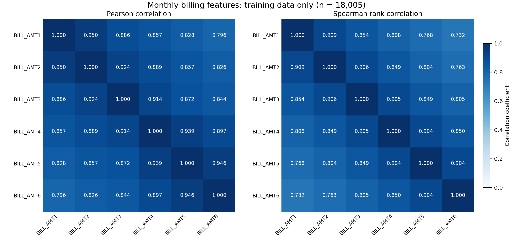
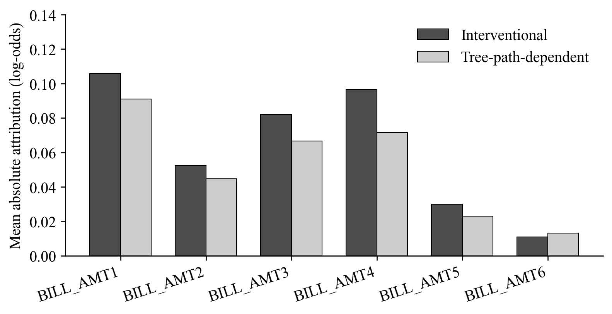
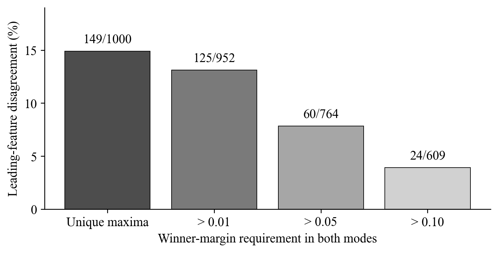
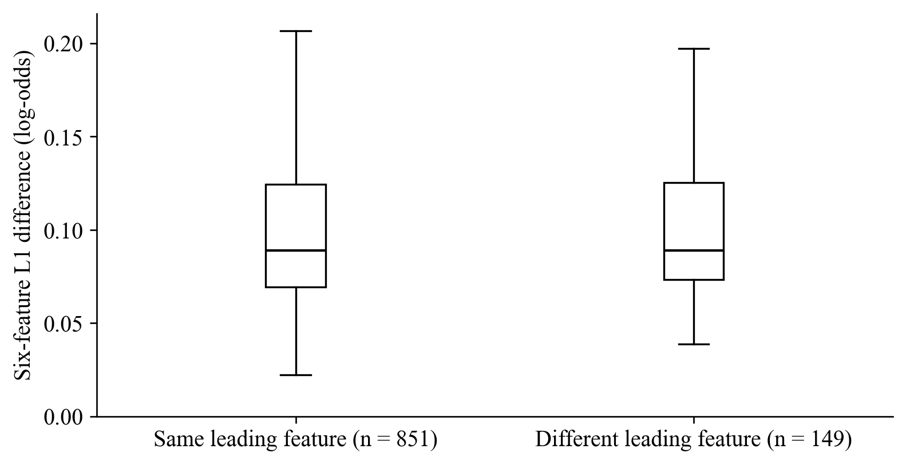
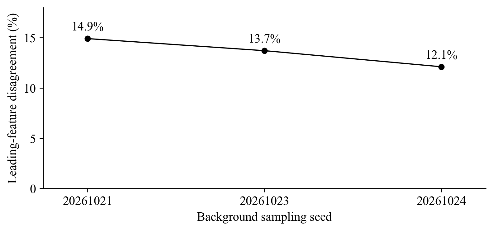

# Sensitivity of TreeSHAP Attributions for Six Correlated Billing Features in Credit Default Prediction

Muhammad Daffa Ade Nugraha - L0124127

Muhammad Yahya Saputra - L0124025

Nurman Aqil Wicaksono - L0124139

Muhammad Irfan - L0124063

Proposed revision for author review - 31 October 2026

## Abstract

Correlated monthly billing variables can receive different attributions under different missing-feature assumptions. This study compares interventional and tree-path-dependent TreeSHAP for BILL_AMT1–BILL_AMT6 in credit default prediction. Four tree-based classifiers are evaluated on a fixed group-aware partition of the UCI Default of Credit Card Clients dataset; XGBoost is selected using validation average precision. The model uses all 23 original predictors, represented by 89 encoded input columns. Both modes explain the same fitted model on 1,000 fixed test observations. Their global billing-feature rankings are identical, but their leading billing features differ for 149 observations (14.9%). Requiring winner margins above 0.05 in both modes retains 764 observations, including 60 disagreements (7.85%). The mean six-feature L1 attribution difference is 0.1051 log-odds units. BILL_AMT1 has the highest mean absolute attribution, whereas BILL_AMT4 has the largest mean paired absolute change. These findings distinguish global ranking agreement from individual allocation agreement. The evaluation is exploratory because the test partition was previously examined; it does not establish that correlation causes disagreement or that either mode is universally correct.

**Keywords:** TreeSHAP; billing features; feature dependence; credit default; attribution sensitivity.

## 1. Introduction

Credit default models use demographic and payment-history information to estimate future default risk. Understanding the contribution of successive monthly bills requires more than identifying a predictive model with a high score. When several variables describe related periods of a customer's financial history, the assignment of model contributions among those variables may depend on how unavailable features are represented in an explanation.

SHAP expresses a model output as a reference value and additive feature contributions [1]. TreeSHAP computes these contributions efficiently for tree-based models [2]. However, the explanation game still depends on its missing-feature assumptions; different Shapley formulations can answer different questions [3]. Interventional and tree-path-dependent TreeSHAP are therefore compared here on the same fitted model and observations, with attention to six billing variables rather than a competition between predictive algorithms.

Related credit-risk research has already examined interventional and path-dependent SHAP [4], and training-seed stability has been studied using repeated XGBoost fits on the Taiwan credit-card dataset [5]. Neither the two modes nor this dataset alone establishes novelty. The empirical question here is whether a stable global ordering of six billing features can conceal different individual allocations, and whether those differences persist beyond near-tied leading features.

The study addresses three research questions:

1. **RQ1:** On the selected default classifier, how do the two TreeSHAP modes differ in the global importance and individual leading feature within BILL_AMT1-BILL_AMT6?
2. **RQ2:** How large are the paired attribution changes for these six variables, and how does leading-feature disagreement change when near-tied winners are separated?
3. **RQ3:** How do the observed billing-attribution patterns vary across sampled backgrounds and a limited set of training seeds?

Four classifiers are compared to select the predictive model used in the main explanation experiment. The main results concern the selected XGBoost model. Other fitted families provide supplementary context in Appendix B. Correlation is measured, not experimentally manipulated, so the study examines attributions for correlated features without attributing mode differences causally to correlation.

## 2. Background

### 2.1. Shapley attribution and TreeSHAP

For an input with feature set N of size M, the Shapley attribution of feature j is

$$
\phi_j = \sum_{S\subseteq N\setminus\{j\}}
\frac{|S|!(M-|S|-1)!}{M!}
\left[v(S\cup\{j\})-v(S)\right].
$$

Here, v(S) defines the model output assigned to a coalition of observed features. Shapley's allocation rule averages a feature's marginal contribution across coalitions [6]. SHAP applies this framework to model explanations [1]. For an additive explanation on the selected output scale,

$$
f(x)=\phi_0+\sum_{j=1}^{M}\phi_j(x).
$$

TreeSHAP exploits tree structure to compute the relevant attributions efficiently [2]. It does not train a separate predictive model for every feature coalition. The interpretation of its output still depends on the value function and reference assumptions.

### 2.2. Two missing-feature treatments

Interventional TreeSHAP uses a supplied background dataset. Missing feature coordinates are replaced using background observations while the observed coordinates are fixed. This operation can break dependencies between observed and replaced features. It does not imply that all features inside a background row are independently sampled. The background also determines the reference output [2], [7].

Tree-path-dependent TreeSHAP uses the tree paths and stored training-sample coverage to weight branches when a feature is unavailable. It does not require a separately supplied background sample [7]. This construction should not be described as an exact estimator of the full observational conditional distribution for arbitrary dependent predictors. Consequently, the two modes can define different explanation games and different baselines while both satisfying additive reconstruction.

### 2.3. Related research and positioning

García-Céspedes et al. examine interventional and path-dependent SHAP in credit-risk applications [4]. Their work establishes that this distinction is already relevant to the domain; the present study does not claim to introduce it. Lin and Wang examine explanation stability under repeated XGBoost training on the Taiwan dataset [5]. Their larger training-seed design addresses a stability dimension for which the three seeds here provide only a limited descriptive check. Work on dependent inputs in energy-system explanations further illustrates that attribution assumptions require attention beyond a single application domain [8].

The present study examines how two explanation specifications allocate credit among six successive billing variables in a selected default classifier. It combines per-feature magnitudes, aggregate ranking agreement, individual leading-feature agreement, and winner-margin diagnostics. Predictive model comparison supports selecting the fitted function to explain; it is not the research endpoint. This empirical focus does not establish priority over all earlier studies, which would require a broader full-text audit.

The distinction from the cited credit-risk studies is the unit of comparison: the main analysis pairs two explanation modes for the same fitted model and observations, then examines local leaders and their margins within six billing variables. This complements the portfolio-reference focus of [4] and the repeated-training stability focus of [5], without claiming a new attribution algorithm.

## 3. Materials and methods

### 3.1. Dataset, predictors, and fixed partition

The UCI Default of Credit Card Clients dataset contains 30,000 customers, 23 predictors, and a binary next-month default target [9]. The records describe Taiwan credit-card customers, including demographic information and repayment, billing, and payment histories from April to September 2005. Default is the positive class and occurs in 6,636 records (22.12%). Customer identifiers are excluded from the predictors.

The preprocessing retains all observations. EDUCATION values 0, 5, and 6 are mapped to an unknown category, while value 4 retains its existing meaning. MARRIAGE value 0 is retained as unknown. Repayment-status values −2, −1, and 0 remain distinct. Negative bills and zero payments are preserved. There are no missing or nonfinite input values requiring imputation. No scaling, clipping, class resampling, or class weighting is applied.

After deterministic category mapping, records are grouped by their complete predictor profiles. The 29,944 distinct profiles include 52 repeated-profile groups containing 108 records. Conflicting target labels within identical profiles are retained. Grouping prevents identical mapped predictor profiles from appearing in different partitions.

A shuffled, stratified five-fold group splitter with seed 20261020 assigns fold 0 to testing, fold 1 to validation, and the other folds to training. This produces one fixed partition; the study does not report five-fold cross-validation averages.

**Table 1. Fixed group-aware data partition.**

| Partition | Records | Non-default | Default | Default prevalence |
| --- | ---: | ---: | ---: | ---: |
| Training | 18,005 | 14,054 | 3,951 | 21.94% |
| Validation | 5,997 | 4,631 | 1,366 | 22.78% |
| Test | 5,998 | 4,679 | 1,319 | 21.99% |

Nine categorical predictors are one-hot encoded using an encoder fitted exclusively on training data. Together with 14 numerical predictors, they yield 89 model input columns. The encoder ignores unknown categories at inference; no unseen categories occur in the held-out partitions. All four models use this same representation.

### 3.2. Six billing features as the analysis target

BILL_AMT1 through BILL_AMT6 are bill statement amounts for September, August, July, June, May, and April 2005, respectively, in New Taiwan dollars [9]. They describe successive histories for the same customers. Training-set pairwise Pearson correlations range from 0.7963 to 0.9501, with mean 0.8816; Spearman correlations range from 0.7324 to 0.9091. Figure 1 shows this dependence structure.

**Figure 1.** Training-set Pearson and Spearman correlations among the six billing variables. Correlations describe the observed group; they do not constitute a controlled dependence experiment.

All 23 original predictors remain available to the classifier. After encoding, TreeSHAP is computed on all 89 model input columns, and the six numerical billing attributions are extracted for analysis. Thus, each billing contribution is interpreted in the context of the full fitted model. The six billing contributions alone need not reconstruct the model output; additive reconstruction includes all input contributions and the baseline. A leading billing feature is the largest absolute attribution within this group, not necessarily the largest attribution among all predictors or the largest positive driver of default risk.

The analysis does not retrain a six-predictor model or define the six bills as one Shapley player. It examines the original model's allocation among these six related coordinates. The payment-amount group is outside the main research questions; its exploratory calculations remain in the supporting project outputs.

### 3.3. Predictive model selection

Random Forest, Extra Trees, Gradient Boosting, and XGBoost are candidate default classifiers [10], [11]. Each uses the same training and validation partitions and encoded inputs. Three depth configurations per family are compared at training seed 42, using validation average precision (AP). The best configuration within each family is retained; an exact tie retains the first candidate. The family with highest validation AP becomes the main classifier for attribution analysis. Candidate settings are reported in Appendix A to keep model selection separate from the explanation question.

AP is a precision-recall summary suitable for evaluating the ranking of the less frequent default class. It is not relabeled as trapezoidal PR-AUC. ROC-AUC, precision, recall, F1, and Brier score supplement AP. Each fitted model's decision threshold maximizes validation F1, with the higher threshold retained when maxima tie. No test metric is used for model selection, and models are not refitted on combined training and validation data. Equal configuration counts are a limited search rather than exhaustive or compute-matched optimization.

The test partition had been examined in the original project. The revision therefore remains exploratory despite using validation data for its selection decisions. After selection, the XGBoost configuration is frozen for retraining at seeds 17 and 73. Results on other families are supplementary analyses of different fitted functions, not alternative criteria for declaring a preferred TreeSHAP mode.

### 3.4. Paired explanations of the selected classifier

The explanation sample consists of 1,000 fixed test observations selected without replacement using seed 20261022. Each interventional background contains 100 training observations, sampled with seeds 20261021, 20261023, and 20261024. The primary XGBoost fit, seed 42, uses all three backgrounds. The additional training seeds use only background 20261021. This design separates limited background and training checks; it is not a complete factorial experiment.

Both modes explain the same default-class raw output of the same fitted model, with identical observations and feature ordering. The approximation option is disabled. For XGBoost, the raw output is the log-odds margin. Native output-margin predictions provide the additive-reconstruction target. Individual contributions are not separately passed through a sigmoid to obtain probability contributions.

A 20-observation pilot precedes the main explanation calculation for each fitted model. XGBoost reconstruction uses an absolute tolerance of 10⁻⁵, documented after a 300-tree pilot showed approximately 1-2 × 10⁻⁶ discrepancies against native float32 margins. Three interventional arrays and one path-dependent array are retained for primary seed 42; each additional seed has one array per mode. These eight arrays constitute the main XGBoost evidence. The wider project retains 32 arrays across all four families.

### 3.5. Measures for the six billing features

For explanation mode m, global importance of feature j is

$$
I_j^{(m)}=\frac{1}{n}\sum_{i=1}^{n}|\phi_{ij}^{(m)}|.
$$

Spearman correlation and Kendall tau-b compare rankings of the six billing importances. They summarize these six-feature vectors descriptively and are not used as population significance tests.

The individual leading billing feature maximizes absolute attribution within the six-feature group. If either mode has a tied maximum within absolute tolerance 10⁻¹², that observation is excluded from the corresponding agreement denominator. The disagreement rate is the fraction of remaining observations whose leading-feature identities differ.

For the largest and second-largest absolute attributions a₁ and a₂, define the winner margin

$$
m=\frac{a_1-a_2}{a_1+a_2},
$$

with zero assigned when the denominator is at most 10⁻¹². Additional comparisons require both modes to have margins exceeding 0.01, 0.05, or 0.10. These thresholds are specified in the analysis protocol. They change the evaluated population, so subset sizes accompany their disagreement rates.

For G = {BILL_AMT1, ..., BILL_AMT6}, paired allocation differences are measured as

$$
D_{L1,G}=\frac{1}{n}\sum_i\sum_{j\in G}
|\phi_{ij}^{(int)}-\phi_{ij}^{(path)}|,
$$

and the absolute difference in the signed group total as

$$
D_{sum,G}=\frac{1}{n}\sum_i
\left|\sum_{j\in G}\phi_{ij}^{(int)}-
\sum_{j\in G}\phi_{ij}^{(path)}\right|.
$$

The first measure includes reallocations among group members; the second can cancel such reallocations. Neither is a prediction-error measure. Summing existing feature attributions does not create a new Shapley game in which the group is a single player. Likewise, source-level summaries of categorical predictors sum signed indicator contributions before taking absolute values; they do not redefine the original encoded-feature game.

## 4. Results

### 4.1. Selection of the classifier to explain

Table 2 reports the candidate families' selected configurations at seed 42. XGBoost obtains the highest validation AP (0.5805) and is selected for the main TreeSHAP analysis. Its test AP is 0.5472 and ROC-AUC is 0.7749. Random Forest has slightly higher test AP (0.5481), which does not change the validation-based choice. These small differences are not treated as statistically established model superiority. The remaining results address the explanations of the selected classifier.

**Table 2. Predictive model selection and held-out evaluation. Threshold-based test metrics use validation-selected thresholds.**

| Model | Validation AP | Test AP | Test ROC-AUC | Precision | Recall | F1 | Brier |
| --- | --- | --- | --- | --- | --- | --- | --- |
| Random Forest | 0.5731 | 0.5481 | 0.7741 | 0.4698 | 0.5770 | 0.5179 | 0.1361 |
| Extra Trees | 0.5640 | 0.5387 | 0.7650 | 0.4802 | 0.5527 | 0.5139 | 0.1372 |
| Gradient Boosting | 0.5757 | 0.5441 | 0.7716 | 0.5050 | 0.5345 | 0.5193 | 0.1356 |
| XGBoost | 0.5805 | 0.5472 | 0.7749 | 0.5169 | 0.5444 | 0.5303 | 0.1351 |

### 4.2. Additive reconstruction and reference values

All eight XGBoost explanation arrays satisfy the specified tolerance; the maximum observed reconstruction error is 4.05 × 10⁻⁶. For seed 42 and background 20261021, the interventional reference is −1.3737 and the path-dependent reference is −1.2748, both in log-odds units. Both explanations reconstruct the same model margin when all 89 input contributions are included.

The different reference values matter: paired feature changes need not be only redistribution inside the six-bill group. Contributions can change relative to other model inputs and the baseline as well. Numerical reconstruction verifies consistency with the model output; it does not identify a correct reference assumption.

### 4.3. Global importance of the six billing features

Table 3 reports the two modes' mean absolute attributions and paired differences for each billing feature. Both modes yield the order BILL_AMT1, BILL_AMT4, BILL_AMT3, BILL_AMT2, BILL_AMT5, and BILL_AMT6. Spearman correlation and Kendall tau-b of these six-feature rankings are both 1.0000. This agreement concerns ordering; the underlying attribution magnitudes differ.

**Table 3. Six-feature attribution comparison for primary XGBoost, seed 42 and background 20261021. All attribution magnitudes are in log-odds units. Ranks are within the billing group.**

| Feature | Mean abs. interventional | Mean abs. path-dependent | Rank in both modes | Mean paired abs. difference |
| --- | --- | --- | --- | --- |
| BILL_AMT1 | 0.1056 | 0.0909 | 1 | 0.0203 |
| BILL_AMT2 | 0.0524 | 0.0447 | 4 | 0.0141 |
| BILL_AMT3 | 0.0820 | 0.0666 | 3 | 0.0182 |
| BILL_AMT4 | 0.0966 | 0.0715 | 2 | 0.0310 |
| BILL_AMT5 | 0.0299 | 0.0231 | 5 | 0.0132 |
| BILL_AMT6 | 0.0110 | 0.0132 | 6 | 0.0083 |

**Figure 2.** Mean absolute attributions of BILL_AMT1-BILL_AMT6 under the two TreeSHAP modes for the selected XGBoost model. The global ordering is unchanged despite differences in attribution magnitude.

BILL_AMT1 has the largest mean absolute attribution under both modes, but BILL_AMT4 has the largest mean paired absolute difference (0.0310). A variable's average importance and its sensitivity to the explanation specification are therefore different properties. Also, the mean absolute paired difference is not generally equal to the difference between the two mean absolute importances.

### 4.4. Individual leading billing features and near ties

All 1,000 primary observations have unique leading billing features in both modes. Their identities differ for 149 observations (14.9%), despite identical global rankings. Thus, aggregate agreement conceals individual differences within the same six-feature group.

Table 4 separates observations by the winner margins in both modes. At margin > 0.05, 764 observations remain and 60 have different leading features (7.85%). At margin > 0.10, the rate is 3.94% among 609 observations. These are conditional disagreement rates on different subsets, not reductions in a fixed population's prediction error. Filtering removes observations with near ties; it does not modify the explanations.

**Table 4. Leading-billing-feature disagreement at different winner-margin requirements, primary XGBoost.**

| Margin requirement in both modes | Eligible observations | Different leading features | Disagreement |
| --- | --- | --- | --- |
| Unique maxima only | 1000 | 149 | 14.90% |
| > 0.01 | 952 | 125 | 13.13% |
| > 0.05 | 764 | 60 | 7.85% |
| > 0.10 | 609 | 24 | 3.94% |

**Figure 3.** Individual leading-feature disagreement among observations satisfying both modes' margin requirement. Labels give disagreements divided by the eligible sample size. The decreasing rates indicate sensitivity of winner counts to near ties but do not isolate a causal explanation for every switched feature.

### 4.5. Magnitude of the six-feature allocation changes

The mean billing L1 difference is 0.1051 log-odds units. The mean absolute difference between the signed billing-group totals is 0.0558. The smaller group-total difference is consistent with cancellation of some changes among the six contributions. These summaries describe allocation changes on the model's margin scale; they are neither probability percentage-point differences nor measures of predictive error.

**Figure 4.** Individual six-feature L1 differences grouped by whether the leading billing feature agrees between modes. Boxes show the median and interquartile range; whiskers extend to observations within 1.5 interquartile ranges. Outlier markers are hidden for readability, while all observations remain in the numerical analysis.

A changed leader need not indicate a large attribution change, and an unchanged leader does not imply identical contributions. The ranking, margin, and magnitude measures should be interpreted together. Neither mode supplies an externally validated attribution ground truth.

### 4.6. Background and training-seed sensitivity

At primary training seed 42, leading-feature disagreement ranges from 12.1% to 14.9% across the three backgrounds (Table 5). The path-dependent explanation is fixed for this fitted model, while the interventional reference and allocations vary with the sampled training background. All three comparisons preserve the same global ranking between modes. Three samples of size 100 do not establish background convergence.

**Table 5. Background sensitivity for primary XGBoost. Each background has 100 training observations; each comparison has 1,000 test observations. L1 values are in log-odds units.**

| Background seed | Different leading features | Disagreement | Mean billing L1 difference |
| --- | --- | --- | --- |
| 20261021 | 149 | 14.9% | 0.1051 |
| 20261023 | 137 | 13.7% | 0.0965 |
| 20261024 | 121 | 12.1% | 0.1033 |

**Figure 5.** Leading-billing-feature disagreement across three training backgrounds for the same fitted XGBoost model. Connected points are a visual guide across categorical background samples, not a convergence curve.

With background 20261021 fixed, the three training seeds yield disagreement rates of 14.9%, 14.9%, and 17.1% (Table 6). All retain identical global billing rankings between modes. Predictions differ across the fitted seeds, but three fits provide a limited descriptive sensitivity check rather than an estimate of population stability or a confidence interval.

**Table 6. Training-seed sensitivity of XGBoost with its selected configuration frozen and background 20261021 fixed; n = 1,000 for each comparison.**

| Training seed | Different leading features | Disagreement | Global Spearman |
| --- | --- | --- | --- |
| 42 | 149 | 14.9% | 1.0000 |
| 17 | 149 | 14.9% | 1.0000 |
| 73 | 171 | 17.1% | 1.0000 |

## 5. Discussion

The central result concerns the six billing variables within the selected XGBoost model: an identical global ordering coexists with different individual leading features for 14.9% of the explained customers. A global importance chart would therefore support a conclusion about average ordering while leaving individual agreement unresolved. For this study, both conclusions are needed because the research object is how contributions are allocated among successive billing periods.

BILL_AMT1 leads in average absolute importance, whereas BILL_AMT4 shows the largest paired change. This distinction prevents a sensitivity analysis from becoming another feature-importance ranking. The question is not only which bill matters most on average, but how much the explanation assigned to each bill changes when the missing-feature treatment changes on the same model.

Winner margins qualify the individual disagreement result. The rate decreases to 7.85% among the 764 observations with both margins above 0.05. This supports examining near ties when reporting leading-feature changes. It does not imply that the excluded observations have unimportant explanations, that the retained subset represents all customers, or that the remaining disagreements are attribution errors. The additional L1 and signed-group-total summaries retain information that a winner identity cannot convey.

The reference distribution is another part of the explanation specification. Background sampling changes the interventional baseline and allocations even when predictions and path-dependent explanations are fixed. Both mode and background should be reported when interpreting the role of a particular billing month. Neither reference is justified here as a causal intervention or a uniquely correct description of a customer's default risk.

The four-model comparison serves predictive selection. It is not the endpoint of the research or evidence that the model with highest AP has the most truthful explanations. Supplementary results on other families show that the frequency and magnitude of billing-attribution changes depend on the fitted function. Those results provide context without replacing the main within-XGBoost comparison or establishing that lower disagreement is inherently better.

## 6. Limitations and reproducibility

The conclusions apply to one dataset, one fixed split, the selected fitted functions, and the sampled references. The test partition had already been examined, so the evaluation is exploratory. The configuration search is limited and does not establish an optimal default classifier. Three training seeds and three backgrounds of size 100 do not establish population uncertainty, convergence, or robustness under portfolio shifts. The design does not cross every background with every seed.

The six bills are observed to be correlated, but their dependence is not manipulated. The experiment therefore cannot attribute mode differences causally to correlation. The attributions also depend on the other predictors retained in the model. A model trained only on six bills, an experiment removing individual bills, and a grouped-player Shapley game would answer different questions and are not claimed as completed here.

One-hot encoding is an additional constraint: masking individual indicators may create categorical combinations absent from the original data. Source-level aggregation does not redefine that encoded-feature game. Additive reconstruction confirms numerical agreement with native model outputs, not substantive attribution correctness. No exhaustive small-tree attribution benchmark, causal analysis, operational lending policy, fairness assessment, or calibration study is established.

The recorded experiment environment uses Python 3.14.7, NumPy 2.3.5, pandas 3.0.1, scikit-learn 1.7.2, SciPy 1.16.2, SHAP 0.54.1, XGBoost 3.4.1, and joblib 1.5.2. The protocol, manifests, and CSV outputs are stored under `game-theory/kredit/experiments/revision_v1/`. The supplied project copy does not yet include the serialized models, fitted encoder, or SHAP arrays; full computational reproduction therefore requires the original binary artifacts. The archived report records 266 consistency checks from the original environment. The present audit checks CSV consistency and does not repeat all model or attribution computations.

The project retains the raw-data fingerprint, partition membership, training-only encoder, candidate scores, selected configurations, predictions, background indices, attribution arrays, and reconstruction diagnostics. Tables in this paper and the focused figures are generated from stored outputs; no model is retrained to produce this revision. These checks support computational traceability without resolving the scientific limitations above.

## 7. Conclusion

For six correlated billing features in the selected XGBoost credit-default model, interventional and tree-path-dependent TreeSHAP preserve the same global importance ordering while identifying different leading billing features for 149 of 1,000 customers. Disagreement remains for 60 of 764 customers after requiring both winner margins to exceed 0.05. BILL_AMT4 has the largest mean paired absolute attribution change, while BILL_AMT1 has the largest mean absolute contribution under both modes.

The findings show why the interpretation of these six features should include per-feature magnitudes, individual agreement, winner margins, and reference settings alongside global rankings. They describe sensitivity of explanations for correlated bills without establishing a causal effect of correlation or a preferred explanation mode. Broader background and training replication, untouched evaluation data, and controlled dependence experiments remain directions for future work.

## Appendix A. Predictive configuration details

At seed 42, Random Forest and Extra Trees vary depth over 8, 12, and unrestricted, with 300 trees, minimum leaf size 5, and square-root feature sampling. Bootstrap sampling is enabled only for Random Forest. Gradient Boosting varies depth over 2, 3, and 4, with 200 stages, learning rate 0.05, minimum leaf size 5, and subsample 1. XGBoost varies depth over 2, 3, and 4, with 300 estimators, learning rate 0.05, row and column sampling fractions 0.8, L2 regularization 1, histogram tree construction, and binary-logistic objective. Native minimum-child settings remain at their defaults. No family uses class weighting or resampling.

**Table 7. Selected configurations retained after validation selection.**

| Model | Trees or stages | Learning rate | Selected maximum depth | Sampling |
| --- | ---: | ---: | --- | --- |
| Random Forest | 300 | — | 12 | Bootstrap; square-root feature sampling |
| Extra Trees | 300 | — | Unrestricted | No bootstrap; square-root feature sampling |
| Gradient Boosting | 200 | 0.05 | 3 | All training rows per stage |
| XGBoost | 300 | 0.05 | 3 | Row fraction 0.8; column fraction 0.8 |

## Appendix B. Supporting billing-attribution results on other models

For context, the completed experiment also evaluates the two modes on the other three selected families using the same six billing features and explanation observations. Table 8 uses training seed 42 and background 20261021, with 1,000 eligible observations per model. These are supporting comparisons, not additional main research targets. Random Forest and Extra Trees explain probability outputs; Gradient Boosting explains log-odds margins. Probability changes are displayed in percentage points (pp) and should not be pooled with boosting magnitudes.

**Table 8. Supplementary six-billing-feature comparisons on the other fitted families.**

| Supporting model | Disagreement | Global Spearman | Mean billing L1 difference | Units |
| --- | --- | --- | --- | --- |
| Random Forest | 42.2% | 0.7714 | 1.1591 | pp |
| Extra Trees | 42.6% | 0.7714 | 0.3041 | pp |
| Gradient Boosting | 21.0% | 1.0000 | 0.0643 | log-odds |

Similar winner-switching rates in the two forest models accompany different L1 differences. This reinforces the need to report magnitudes together with winner identities. The different fitted functions and output scales prevent interpreting these rates as a causal effect of model architecture. Complete background and seed tables remain in the stored experiment outputs. The supporting arrays pass their documented reconstruction tolerances of 10⁻⁶ for the scikit-learn families; verified historical Random Forest arrays retain their provenance records.

## References

[1] S. M. Lundberg and S.-I. Lee, “A unified approach to interpreting model predictions,” in *Advances in Neural Information Processing Systems*, vol. 30, 2017. [Online]. Available: [proceedings.neurips.cc](https://proceedings.neurips.cc/paper/2017/hash/8a20a8621978632d76c43dfd28b67767-Abstract.html).

[2] S. M. Lundberg *et al.*, “From local explanations to global understanding with explainable AI for trees,” *Nature Machine Intelligence*, vol. 2, pp. 56-67, 2020, doi: [10.1038/s42256-019-0138-9](https://doi.org/10.1038/s42256-019-0138-9).

[3] M. Sundararajan and A. Najmi, “The many Shapley values for model explanation,” in *Proc. 37th Int. Conf. Machine Learning*, vol. 119, 2020, pp. 9269-9278. [Online]. Available: [https://proceedings.mlr.press/v119/sundararajan20b.html](https://proceedings.mlr.press/v119/sundararajan20b.html).

[4] R. García-Céspedes, F. J. Alias-Carrascosa, and M. Moreno, “On Machine Learning models explainability in the banking sector: the case of SHAP,” *Journal of the Operational Research Society*, vol. 76, no. 12, pp. 2591-2603, 2025, doi: [10.1080/01605682.2025.2485263](https://doi.org/10.1080/01605682.2025.2485263).

[5] L. Lin and Y. Wang, “SHAP stability in credit risk management: A case study in credit card default model,” *Risks*, vol. 13, no. 12, Art. no. 238, 2025, doi: [10.3390/risks13120238](https://doi.org/10.3390/risks13120238).

[6] L. S. Shapley, “A value for n-person games,” in *Contributions to the Theory of Games II*, H. W. Kuhn and A. W. Tucker, Eds. Princeton, NJ, USA: Princeton University Press, 1953, pp. 307-317, doi: [10.1515/9781400881970-018](https://doi.org/10.1515/9781400881970-018).

[7] SHAP developers, “shap.TreeExplainer,” *SHAP documentation*. Accessed: Oct. 23, 2026. [Online]. Available: [https://shap.readthedocs.io/en/latest/generated/shap.TreeExplainer.html](https://shap.readthedocs.io/en/latest/generated/shap.TreeExplainer.html).

[8] A. Nikoltchovska, S. Pütz, M. Götz, and B. Schäfer, “Correlations matter in explanations for energy systems,” *KI - Künstliche Intelligenz*, vol. 40, pp. 41-54, 2026, doi: [10.1007/s13218-026-00904-4](https://doi.org/10.1007/s13218-026-00904-4).

[9] I. Yeh, “Default of credit card clients,” *UCI Machine Learning Repository*, 2009, doi: [10.24432/C55S3H](https://doi.org/10.24432/C55S3H).

[10] Scikit-learn developers, “Ensemble methods,” *Scikit-learn 1.7 documentation*. Accessed: Oct. 23, 2026. [Online]. Available: [https://scikit-learn.org/1.7/modules/ensemble.html](https://scikit-learn.org/1.7/modules/ensemble.html).

[11] XGBoost developers, “XGBoost parameters,” *XGBoost documentation*. Accessed: Oct. 23, 2026. [Online]. Available: [https://xgboost.readthedocs.io/en/stable/parameter.html](https://xgboost.readthedocs.io/en/stable/parameter.html).
