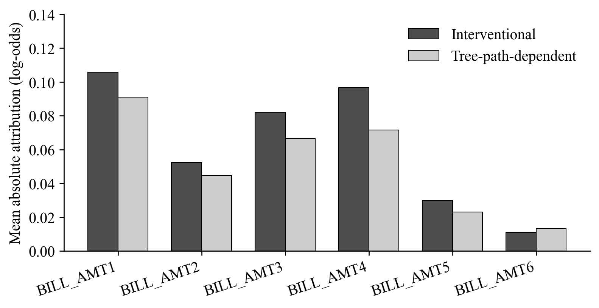

# Sensitivity of TreeSHAP Attributions for Six Correlated Billing Features in Credit Default Prediction

Muhammad Daffa Ade Nugraha - L0124127

Muhammad Yahya Saputra - L0124025

Nurman Aqil Wicaksono - L0124139

Muhammad Irfan - L0124063

## Abstract

Correlated monthly billing variables can receive different attributions under different missing-feature assumptions. This study compares interventional and tree-path-dependent TreeSHAP for BILL_AMT1–BILL_AMT6 in credit default prediction. Four tree-based classifiers are evaluated on a fixed group-aware partition of the UCI Default of Credit Card Clients dataset; XGBoost is selected using validation average precision. The model uses all 23 original predictors, represented by 89 encoded input columns. Both modes explain the same fitted model on 1,000 fixed test observations. Their global billing-feature rankings are identical, but their leading billing features differ for 149 observations (14.9%). Requiring winner margins above 0.05 in both modes retains 764 observations, including 60 disagreements (7.85%). The mean six-feature L1 attribution difference is 0.1051 log-odds units. BILL_AMT1 has the highest mean absolute attribution, whereas BILL_AMT4 has the largest mean paired absolute change. These findings distinguish global ranking agreement from individual allocation agreement. The evaluation is exploratory because the test partition was previously examined; it does not establish that correlation causes disagreement or that either mode is universally correct.

**Keywords:** TreeSHAP; billing features; feature dependence; credit default; attribution sensitivity.

## I. Introduction

Credit default models use demographic and payment-history information to estimate future default risk. Understanding the contribution of successive monthly bills requires more than identifying a predictive model with a high score. When several variables describe related periods of a customer's financial history, the assignment of model contributions among those variables may depend on how unavailable features are represented in an explanation.

SHAP expresses a model output as a reference value and additive feature contributions [1]. TreeSHAP computes these contributions efficiently for tree-based models [2]. However, the explanation game still depends on its missing-feature assumptions; different Shapley formulations can answer different questions [3]. Interventional and tree-path-dependent TreeSHAP are therefore compared here on the same fitted model and observations, with attention to six billing variables rather than a competition between predictive algorithms.

Related credit-risk research has already examined interventional and path-dependent SHAP [4], and training-seed stability has been studied using repeated XGBoost fits on the Taiwan credit-card dataset [5]. Neither the two modes nor this dataset alone establishes novelty. The empirical question here is whether a stable global ordering of six billing features can conceal different individual allocations, and whether those differences persist beyond near-tied leading features.

This minipaper asks whether identical global rankings can conceal different individual leading billing features, whether disagreements persist beyond near ties, and how results vary across a limited set of backgrounds and training seeds. Correlation is measured rather than manipulated.

## II. Background

For an input with feature set N of size M, the Shapley attribution of feature j is

$$
\phi_j = \sum_{S\subseteq N\setminus\{j\}}
\frac{|S|!(M-|S|-1)!}{M!}
\left[v(S\cup\{j\})-v(S)\right].
$$

Here, v(S) defines the model output assigned to a coalition of observed features. Shapley's allocation rule averages a feature's marginal contribution across coalitions [6]. SHAP applies this framework to model explanations [1]. For an additive explanation on the selected output scale,

$$
f(x)=\phi_0+\sum_{j=1}^{M}\phi_j(x).
$$

TreeSHAP exploits tree structure to compute the relevant attributions efficiently [2]. It does not train a separate predictive model for every feature coalition. The interpretation of its output still depends on the value function and reference assumptions.

Interventional TreeSHAP replaces missing coordinates using a supplied background sample while holding observed coordinates fixed. This can break dependence between observed and replaced features without independently sampling every coordinate in a background row. Tree-path-dependent TreeSHAP instead weights unavailable branches using stored training coverage and needs no separate background sample [7]. It is not an exact estimator of arbitrary observational conditional distributions. The modes can therefore define different explanation games and baselines.

The credit-risk comparison in [4] concerns explanation modes and portfolio references; [5] studies stability under repeated XGBoost training. This study complements them through paired local-leading-feature and winner-margin diagnostics within six bills. Dependence-aware explanations also matter beyond credit risk [8]. No first-in-field claim is made.

## III. Materials and Methods

### A. Data and partition

The UCI Default of Credit Card Clients dataset contains 30,000 Taiwanese customers, 23 predictors, and a binary next-month default target [9]. Default occurs in 6,636 records (22.12%). ID is excluded. EDUCATION codes 0/5/6 are mapped to unknown, while code 4 retains its meaning; MARRIAGE code 0 is retained as unknown. Repayment codes -2/-1/0, negative bills, and zero payments remain distinct. No rows are removed; no imputation, scaling, resampling, or class weighting is applied.

Identical mapped predictor profiles are grouped before splitting: 29,944 profiles include 52 repeated groups containing 108 records. A shuffled StratifiedGroupKFold splitter with five folds and seed 20261020 assigns fold 0 to test, fold 1 to validation, and the others to training. This is one fixed partition, not averaged cross-validation. Training/validation/test contain 18,005/5,997/5,998 observations and 3,951/1,366/1,319 defaults, respectively.

A training-only one-hot encoder maps nine categorical predictors to 75 indicators; 14 numerical predictors give 89 model inputs. BILL_AMT1–BILL_AMT6 remain numerical and describe September through April 2005 bills in New Taiwan dollars. Training Pearson correlations range from 0.7963 to 0.9501 (mean 0.8816); Spearman correlations range from 0.7324 to 0.9091. The model uses all predictors: six bills are the attribution-analysis target, not the complete input set.

### B. Model selection and explanations

Random Forest, Extra Trees, Gradient Boosting, and XGBoost are compared [10], [11]. Each family has three depth candidates, selected at seed 42 using validation average precision (AP); exact ties retain the first candidate. Forest candidates use 300 trees, depth 8/12/unrestricted, minimum leaf size 5, and square-root feature sampling. Bootstrap is enabled only for Random Forest. Gradient Boosting uses 200 stages, learning rate 0.05, depth 2/3/4, minimum leaf size 5, and subsample 1. XGBoost uses 300 trees, depth 2/3/4, learning rate 0.05, row/column fractions 0.8, L2 penalty 1, histogram construction, and binary-logistic objective.

XGBoost is selected with depth 3. Models are not refitted on train plus validation. Additional training seeds 17 and 73 use the frozen selected configuration. Equal candidate counts are not exhaustive or compute-matched optimization. Test was previously examined, so evaluation remains exploratory.

Both modes explain the same fitted model and 1,000 fixed test observations sampled without replacement (seed 20261022). Interventional backgrounds contain 100 training observations each, with seeds 20261021/20261023/20261024. Training seed 42 uses all three; seeds 17/73 use only background 20261021. This is not a full factorial design.

TreeExplainer uses explicit perturbation modes, raw output, and approximate=False. XGBoost raw output is the default-class log-odds margin. Additivity includes all 89 contributions and the baseline; six billing contributions alone need not reconstruct output. Individual contributions are not separately transformed by sigmoid. A 20-observation pilot precedes each main calculation; the XGBoost absolute reconstruction tolerance is 1e-5 after documented float32 pilot discrepancies.

### C. Attribution measures

Global importance is mean absolute SHAP. Spearman correlation and Kendall tau-b compare the six-feature importance rankings descriptively. The individual leader maximizes absolute attribution within six bills; it need not be the strongest positive risk driver or the leading feature across all inputs. Tied maxima within absolute tolerance 1e-12 in either mode are excluded.

For the two largest absolute contributions a1 and a2, the winner margin is (a1-a2)/(a1+a2), or zero when the denominator is at most 1e-12. Disagreement is reported without a margin cutoff and when both margins exceed 0.01/0.05/0.10, with each eligible denominator. Mean billing L1 difference sums absolute paired changes across six contributions before averaging. Mean absolute signed-group-total difference instead allows cancellation among features. Neither is prediction error, and summing feature contributions does not define a grouped-player Shapley game.

## IV. Results and Discussion

### A. Predictive selection and numerical consistency

Table I shows the validation-based choice. Random Forest has slightly higher test AP, which does not change the selected family or establish statistically significant superiority.

**Table I. AP-based selection; the last column is test ROC-AUC.**

| Model | Val. AP | Test AP | ROC-AUC |
| --- | --- | --- | --- |
| Random Forest | 0.5731 | 0.5481 | 0.7741 |
| Extra Trees | 0.5640 | 0.5387 | 0.7650 |
| Gradient Boosting | 0.5757 | 0.5441 | 0.7716 |
| XGBoost | 0.5805 | 0.5472 | 0.7749 |

The archived eight XGBoost arrays satisfy the recorded tolerance, with maximum error 4.05e-6. For seed 42 and background 20261021, baselines are -1.3737 (interventional) and -1.2748 (path-dependent), in log-odds. Different baselines mean changes need not be redistribution within the billing group alone. Reconstruction checks numerical consistency, not attribution correctness.

### B. Global agreement and individual disagreement

Both modes rank bills as BILL_AMT1, BILL_AMT4, BILL_AMT3, BILL_AMT2, BILL_AMT5, BILL_AMT6; Spearman and Kendall tau-b are 1.0000. Figure 1 shows that magnitude agreement does not follow from ranking agreement. BILL_AMT1 has the largest mean absolute contribution (0.1056/0.0909 interventional/path-dependent), whereas BILL_AMT4 has the largest mean paired absolute change (0.0310).

**Figure 1.** Mean absolute billing attributions for primary XGBoost, seed 42 and background 20261021, in log-odds units.

All 1,000 primary observations have unique leaders in both modes. Leaders differ in 149 observations (14.9%). Table II shows that disagreement remains when near-tied leaders are excluded. The lower rates concern different subsets; filtering does not alter explanations or reduce model prediction error.

**Table II. Disagreement conditional on both winner margins.**

| Cutoff | Eligible | Different | Rate |
| --- | --- | --- | --- |
| None (unique) | 1000 | 149 | 14.90% |
| >0.01 | 952 | 125 | 13.13% |
| >0.05 | 764 | 60 | 7.85% |
| >0.10 | 609 | 24 | 3.94% |

Mean billing L1 difference is 0.1051 log-odds; mean absolute signed-group-total difference is 0.0558. The smaller total is consistent with cancellation among contributions. A leader can switch with small changes, while an unchanged leader can conceal changes in other contributions. Global rankings, local identities, margins, and magnitudes answer complementary questions.

### C. Limited sensitivity checks

At training seed 42, the three backgrounds yield disagreement rates of 14.9%, 13.7%, and 12.1%, with L1 differences 0.1051, 0.0965, and 0.1033. With background 20261021 fixed, training seeds 42/17/73 yield 14.9%/14.9%/17.1%. All these within-model comparisons retain identical rankings between modes. Three backgrounds of size 100 do not establish convergence, and three fits do not estimate population stability. Full per-feature and supporting-model tables remain in the project outputs.

## V. Limitations and Reproducibility

The study concerns one dataset, a previously examined test partition, selected functions, and sampled references. Correlation is not manipulated, so it cannot be established as the cause of disagreement. No ground-truth attribution validates either mode. One-hot masking may create unnatural categorical combinations; source-level aggregation does not change the encoded-feature game. Fairness, operational lending policy, and calibration are not evaluated.

The recorded environment is Python 3.14.7, NumPy 2.3.5, pandas 3.0.1, scikit-learn 1.7.2, SciPy 1.16.2, SHAP 0.54.1, XGBoost 3.4.1, and joblib 1.5.2. Protocols, manifests, and CSV outputs are in kredit/experiments/revision_v1/. The original report records 266 checks; a later CSV audit does not repeat all model/SHAP computations. The supplied copy lacks serialized models, fitted encoder, and NPZ arrays, which are required for full reproduction. This minipaper uses stored results and does not retrain models.

For the UAS extension, larger crossed seed/background experiments, varied background sizes, untouched new evaluation data, and controlled-dependence synthetic experiments are planned, not completed findings.

## VI. Conclusion

Identical global rankings coexist with different leading billing features in 149/1,000 observations; disagreement persists in 60/764 observations after both winner margins exceed 0.05. BILL_AMT1 leads in average importance, whereas BILL_AMT4 changes most between modes. This exploratory case study supports reporting local agreement, margins, magnitudes, and reference settings alongside global rankings, without identifying a universally correct mode or a causal effect of correlation.

## References

[1] S. M. Lundberg and S.-I. Lee, “A unified approach to interpreting model predictions,” in *Advances in Neural Information Processing Systems*, vol. 30, 2017. [Online]. Available: [proceedings.neurips.cc](https://proceedings.neurips.cc/paper/2017/hash/8a20a8621978632d76c43dfd28b67767-Abstract.html).

[2] S. M. Lundberg *et al.*, “From local explanations to global understanding with explainable AI for trees,” *Nature Machine Intelligence*, vol. 2, pp. 56-67, 2020, doi: [10.1038/s42256-019-0138-9](https://doi.org/10.1038/s42256-019-0138-9).

[3] M. Sundararajan and A. Najmi, “The many Shapley values for model explanation,” in *Proc. 37th Int. Conf. Machine Learning*, vol. 119, 2020, pp. 9269-9278. [Online]. Available: [https://proceedings.mlr.press/v119/sundararajan20b.html](https://proceedings.mlr.press/v119/sundararajan20b.html).

[4] R. García-Céspedes, F. J. Alias-Carrascosa, and M. Moreno, “On Machine Learning models explainability in the banking sector: the case of SHAP,” *Journal of the Operational Research Society*, vol. 76, no. 12, pp. 2591-2603, 2025, doi: [10.1080/01605682.2025.2485263](https://doi.org/10.1080/01605682.2025.2485263).

[5] L. Lin and Y. Wang, “SHAP stability in credit risk management: A case study in credit card default model,” *Risks*, vol. 13, no. 12, Art. no. 238, 2025, doi: [10.3390/risks13120238](https://doi.org/10.3390/risks13120238).

[6] L. S. Shapley, “A value for n-person games,” in *Contributions to the Theory of Games II*, H. W. Kuhn and A. W. Tucker, Eds. Princeton, NJ, USA: Princeton University Press, 1953, pp. 307-317, doi: [10.1515/9781400881970-018](https://doi.org/10.1515/9781400881970-018).

[7] SHAP developers, “shap.TreeExplainer,” *SHAP documentation*. Accessed: Oct. 23, 2026. [Online]. Available: [https://shap.readthedocs.io/en/latest/generated/shap.TreeExplainer.html](https://shap.readthedocs.io/en/latest/generated/shap.TreeExplainer.html).

[8] A. Nikoltchovska, S. Pütz, M. Götz, and B. Schäfer, “Correlations matter in explanations for energy systems,” *KI - Künstliche Intelligenz*, vol. 40, pp. 41-54, 2026, doi: [10.1007/s13218-026-00904-4](https://doi.org/10.1007/s13218-026-00904-4).

[9] I. Yeh, “Default of credit card clients,” *UCI Machine Learning Repository*, 2009, doi: [10.24432/C55S3H](https://doi.org/10.24432/C55S3H).

[10] Scikit-learn developers, “Ensemble methods,” *Scikit-learn 1.7 documentation*. Accessed: Oct. 23, 2026. [Online]. Available: [https://scikit-learn.org/1.7/modules/ensemble.html](https://scikit-learn.org/1.7/modules/ensemble.html).

[11] XGBoost developers, “XGBoost parameters,” *XGBoost documentation*. Accessed: Oct. 23, 2026. [Online]. Available: [https://xgboost.readthedocs.io/en/stable/parameter.html](https://xgboost.readthedocs.io/en/stable/parameter.html).
